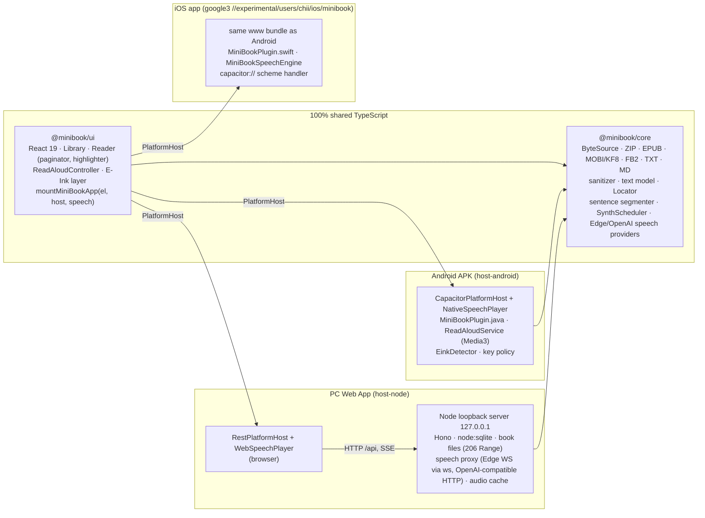
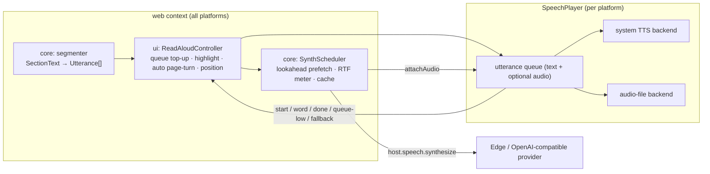
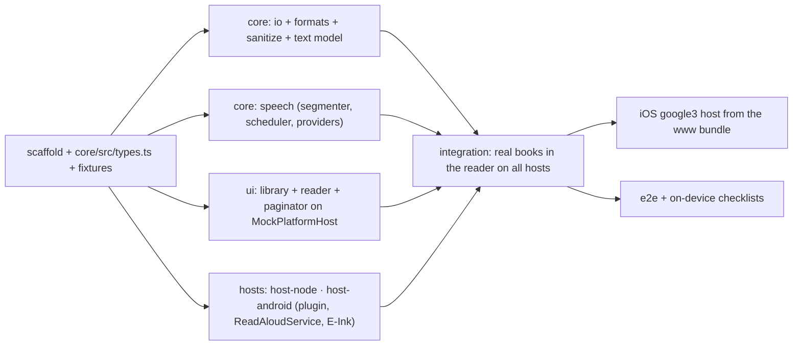

# MiniBook — Architecture (100 % TypeScript core · Android + iOS + PC Web App)

> **Revision V2** (resolves design-critic review #5). Companion to [PRODUCT_DESIGN.md](PRODUCT_DESIGN.md) and [TTS_RESEARCH.md](TTS_RESEARCH.md). This is the build contract for the `minibook` pnpm monorepo, modelled on MiniPod (`~/Developer/minipod`) and Kotori: **one shared core, one shared UI, thin hosts**. Everything crossing a package boundary is typed in `packages/core/src/types.ts`.

---

## 0. Ground rules

| Rule | Detail |
|---|---|
| **Toolchain** | Same as MiniPod: Node ≥ 22.5 (`node:sqlite`), pnpm 10, TypeScript 5.9 (`strict`, `exactOptionalPropertyTypes`, `noUncheckedIndexedAccess`, `verbatimModuleSyntax`), Vitest 4, Vite 7, React 19, Capacitor 8. Workspace packages are consumed as TS source. |
| **Zero native addons** | `pnpm-workspace.yaml`: `onlyBuiltDependencies: []` + `overrides` deleting `better-sqlite3`, `sqlite3`, `sharp`, `canvas`, `bufferutil`, `utf-8-validate`; `pnpm check:native` scans the production tree for `.node` / `binding.gyp` / `node-gyp-build` / `prebuild-install`. All book parsing, decompression, sanitising and speech-protocol code is pure TS/JS. |
| **Runtime dependencies (complete list)** | `core`: **`fflate`** (pure-JS inflate/zlib, MIT) and **`parse5`** (pure-JS spec-compliant HTML5 parser, MIT). `ui`: `react`, `react-dom`, `zustand`. `host-node`: `hono`, `@hono/node-server`, **`ws`** (pure JS; its optional native accelerators are the two packages already deleted by `overrides`). `host-android`: `@capacitor/{core,android,app}`. Nothing else ships. |
| **`core` is platform-neutral** | No `node:*`, no DOM, no Capacitor. Allowed globals: `TextDecoder/TextEncoder`, `crypto.subtle`, `URL`, `AbortController`, typed arrays. All I/O is injected (`ByteSource`, `HttpTransport`, `SocketTransport`, `now()`). Consequently every parser and the whole TTS scheduler run identically in Node (tests, PC server), the Android WebView, `WKWebView` and desktop browsers. |
| **Engine baseline** | Android System WebView / Chrome **≥ 87**, iOS **≥ 17** (`WKWebView`), desktop Chrome/Edge ≥ 105, Firefox ≥ 115, Safari ≥ 16.4. Build target `es2020`. Newer CSS/JS (CSS Custom Highlight API, `text-autospace`, `:has`) is progressive enhancement behind feature checks. A WebView older than the baseline gets a static "Update Android System WebView" page. Rationale: many E-Ink devices run Android 9–11 with stale WebViews. |
| **Errors** | `MiniBookError(code, message, { details })`; codes: `unsupported-format`, `drm-protected`, `corrupt-book`, `too-large`, `not-found`, `invalid-argument`, `network`, `speech-unavailable`, `speech-auth`, `cancelled`, `unsupported`. Hosts serialise with `toShape()`; UI switches on `error.code`. |
| **Verify before handoff** | `pnpm install && pnpm typecheck && pnpm test && pnpm check:native` green. Browser-layout tests (`pnpm test:e2e`, Playwright) are a separate, Linux-only job because they download browser binaries that corporate macOS policy may block. |

## 1. System overview



**Where code runs.** Book parsing, sanitising, pagination and Read-Aloud orchestration run in the **web context** on every platform (browser tab, Android WebView, `WKWebView`) using `@minibook/core`. Hosts provide bytes, persistence, speech output and device integration. The PC server additionally runs core for CLI imports and as the speech-provider runtime.

### 1.1 Dependency graph (enforced by a lint test)

```
core         → fflate, parse5
ui           → core, react, react-dom, zustand
host-node    → core, ui (web entry only), hono, @hono/node-server, ws
host-android → core, ui, @capacitor/{core,android,app}        (its www/ bundle is also the iOS bundle)
```

### 1.2 Per-platform responsibilities

| Concern | PC Web (host-node) | Android (host-android) | iOS (google3) |
|---|---|---|---|
| Book bytes | `GET /api/books/:id/file` with HTTP Range (Node honours `end`) | **bounded native reads:** `MiniBookPlugin.fs.read({path, offset, length})` backed by `RandomAccessFile` (§3.3). The stock Capacitor `WebViewLocalServer` is **not** used for ranges — it answers `Range` with `skip(start)` and then streams to EOF | same plugin method backed by `FileHandle` (`seek` + `read(upToCount:)`) |
| Persistence | `node:sqlite` + files under `~/.minibook/` | JSON + files in app-private storage via `MiniBookPlugin.fs` (atomic writes) | same layout in `Application Support/MiniBookData` |
| System TTS | browser `speechSynthesis` (JS) | `TextToSpeech` inside `ReadAloudService` | `AVSpeechSynthesizer` inside `MiniBookSpeechEngine` |
| Synth-engine network | server-side (no CORS, custom WS headers via `ws`) | `MiniBookPlugin.http` / `.socket` (OkHttp) | `MiniBookPlugin.http` / `.socket` (`URLSession`) |
| Audio playback of synthesized speech | `<audio>` elements | ExoPlayer inside `ReadAloudService` | `AVQueuePlayer` inside `MiniBookSpeechEngine` |
| Background / lock screen | Media Session API | Media3 `MediaSessionService` (foreground, `mediaPlayback`) | `AVAudioSession(.playback,.spokenAudio)` + Now Playing + remote commands |
| E-Ink detection / refresh / volume keys | media queries · software flash | `EinkDetector` · vendor refresh or software flash · `dispatchKeyEvent` policy | media queries · software flash · (no key capture) |

## 2. Repository layout

```
minibook/
├── package.json · pnpm-workspace.yaml · tsconfig.base.json · vitest.config.ts
├── scripts/check-native-deps.mjs · scripts/bump-version.mjs
├── DESIGN.md · ARCHITECTURE.md · TTS_RESEARCH.md · NOTICE (foliate-js MIT attribution, fonts OFL)
├── fixtures/                         real books + adversarial samples (§14)
└── packages/
    ├── core/src/
    │   ├── types.ts                  ALL shared types + PlatformHost + SpeechPlayer contracts
    │   ├── errors.ts
    │   ├── io/                       ByteSource.ts · zip.ts (central-directory reader) · binary.ts (DataView cursor) · encoding.ts (detect/decode)
    │   ├── markup/                   xml-tokenizer.ts · html.ts (parse5 → MNode) · mnode.ts · entities.ts · serialize.ts
    │   ├── formats/                  detect.ts · epub/{container,opf,nav,ncx,obfuscation}.ts · mobi/{pdb,palmdoc,huffcdic,mobi-header,exth,indx,kf8,mobi6,resources}.ts
    │   │                             fb2/fb2.ts · txt/{chapters,txt}.ts · md/markdown.ts
    │   ├── book/                     BookSession.ts (uniform interface) · sanitize.ts · css.ts · text-model.ts · locator.ts · search.ts · inspect.ts
    │   ├── speech/                   segmenter.ts · lang.ts · utterance.ts · SynthScheduler.ts · cache-key.ts
    │   │                             providers/{EdgeSpeechProvider,OpenAiSpeechProvider}.ts · transports.ts
    │   └── util/                     sha1.ts · base32.ts · lru.ts · abort.ts
    ├── ui/src/
    │   ├── index.ts                  mountMiniBookApp(container, host, speechPlayer)
    │   ├── app/                      App.tsx · routes.ts · back.ts (window.__minibookHandleBack) · keymap.ts
    │   ├── theme/                    tokens.css · themes.css · eink.css · fonts/ (Literata woff2)
    │   ├── host/                     HostContext.tsx · mock-host.ts (MockPlatformHost + MockSpeechPlayer)
    │   ├── library/                  LibraryScreen.tsx · CoverTile.tsx · ImportController.ts
    │   ├── reader/                   ReaderScreen.tsx · SectionFrame.ts (iframe + CSP) · Paginator.ts · TextMap.ts · Highlighter.ts
    │   │                             ResourceUrls.ts · user-stylesheet.ts · Chrome.tsx · sheets/{Appearance,Contents}.tsx
    │   ├── speech/                   ReadAloudController.ts · ReadAloudBar.tsx · VoiceSheet.tsx · WebSpeechPlayer.ts · AutoPageTurn.ts
    │   ├── eink/                     PagedList.tsx · RefreshController.ts · FlashOverlay.tsx · freeze-images.ts
    │   ├── components/               Sheet · Stepper · Toggle · IconButton · Segmented (each with a specified E-Ink form)
    │   └── i18n/                     en.ts · zh-CN.ts · ja.ts
    ├── host-node/
    │   ├── bin/minibook.mjs · build.mjs · web/{index.html,main.tsx}
    │   └── src/{shared/routes.ts, client/rest-host.ts, server/{main,app,routes/*}.ts, db/{sqlite.ts,migrations/001_init.sql,repositories/*},
    │           speech/{synth-service.ts, ws-transport.ts, http-transport.ts, audio-cache.ts}, settings/secrets.ts}
    └── host-android/
        ├── capacitor.config.ts       appId dev.minibook.app · appName Books · webDir www · androidScheme https
        ├── web/{index.html,main.tsx} mountMiniBookApp(el, createCapacitorPlatformHost(), new NativeSpeechPlayer())
        ├── src/{capacitor-host.ts, storage/FileLibraryStore.ts, storage/PluginByteSource.ts, speech/NativeSpeechPlayer.ts, speech/plugin-transports.ts, plugin-types.ts}
        └── android/app/src/main/java/dev/minibook/app/
            MainActivity.java · MiniBookPlugin.java · ReadAloudService.java · ReadAloudPlayer.java (SimpleBasePlayer)
            SystemTtsBackend.java · FilePlayerBackend.java · SpeechJournal.java · EinkDetector.java · EinkRefresher.java · KeyPolicy.java
```

iOS lives in google3 (§11) and consumes `packages/host-android/www` exactly as MiniPod iOS does.

## 3. Contracts (`core/src/types.ts`)

```ts
export interface PlatformHost {
  info: HostInfo;            // { platform: 'desktop'|'android'|'ios', appVersion, capabilities, device: DeviceInfo }
  library: LibraryApi;       // list(), get(id), beginImport(src) → ImportTicket, commitImport(ticket, inspected), remove(id),
                             // setFinished(id, bool), coverUrl(id): string | null
  files: FilesApi;           // pickBooks(): Promise<ImportSource[]>, byteSource(bookId): ByteSource, openExternal(url)
  state: StateApi;           // getPosition(bookId), savePosition(bookId, pos), listBookmarks(bookId), addBookmark, removeBookmark
  settings: SettingsApi;     // get(), update(patch); secrets: setSecret(name, value), hasSecret(name)
  speech: SpeechHostApi;     // synthesize(req, signal): Promise<SynthResult>, listRemoteVoices(engine), clearCache(), cacheSize()
  device: DeviceApi;         // setImmersive(bool), setKeepScreenOn(bool), fullRefresh(): Promise<boolean>, setKeyPolicy(policy)
  subscribe(l: (e: HostEvent) => void): Unsubscribe;   // library-changed | import-progress | hardware-key | incoming-file | device-changed
}

export interface HostCapabilities {
  nativeSpeechQueue: boolean;   // android/ios true: speech survives a sleeping web layer
  volumeKeyPaging: boolean;     // android only
  vendorRefresh: boolean;       // android on supported E-Ink vendors
  einkDetected: boolean;        // native fingerprint (android) — media queries are evaluated in the UI
  filePicker: boolean; openWith: boolean;
}

/** Random-access bytes; the only way core touches a book file. */
export interface ByteSource {
  readonly size: number;
  read(offset: number, length: number): Promise<Uint8Array>;   // MUST transfer only `length` bytes (bounded on every host)
  readAll?(): Promise<Uint8Array>;                              // optional fast path for whole-file consumers (import-time only)
}
```

Semantics: capabilities over exceptions (hidden, not disabled); `state.savePosition` is fire-and-forget for the UI (hosts persist atomically, UI debounces to 1 s and flushes on `pagehide`/pause); speech **playback** is not a host method — it is a `SpeechPlayer` (§8.3) handed to `mountMiniBookApp`, exactly like MiniPod's `PlayerEngine`.

### 3.1 Desktop wire format

`/api` JSON envelope `{ ok, data | error }` as in MiniPod, typed route table shared by client and server (a test asserts full coverage), `GET /api/events` (SSE). Binary routes: `POST /api/books` (raw body → temp file), `GET /api/books/:id/file` (206 Range, `ETag`), `GET /api/books/:id/cover`, `GET /api/speech/audio/:key`. The server binds `127.0.0.1` only and rejects requests whose `Host`/`Origin` is not its own loopback origin (DNS-rebinding / cross-site request guard — it can make outbound speech requests, so it must not be drivable by other web pages).

### 3.2 Native plugin surface (`MiniBook`; same method names on Android (Java) and iOS (Swift), declared once in `host-android/src/plugin-types.ts`)

| Group | Methods / events |
|---|---|
| `fs` | **`read({path, offset, length}) → base64`** (bounded random access: `RandomAccessFile.seek` + `readFully` on Android, `FileHandle` on iOS; `length ≤ 1 MiB` per call — this is the book `ByteSource`), `writeAtomic({path, text | base64})` (tmp + fsync + rename), `append({path, base64})` (import-time derived files), `list`, `remove`, `stat`, `fileUrl({path}) → url` (whole-file `fetch` only, never with `Range`) |
| `import` | `pick({multiple:true}) → [{tempPath, name, size}]` (SAF / `UIDocumentPicker`; content is **copied** into `tmp/`), `adopt({tempPath, bookId, ext})`; event `incoming-file` for *Open with* / share intents |
| `http` | `request({url, method, headers, bodyBase64?, timeoutMs}) → {status, headers, bodyBase64}` — CORS-free, used only by speech providers |
| `socket` | `open({id, url, headers})`, `send({id, text | base64})`, `close({id})`; events `socket-open`, `socket-message {id, text | base64}`, `socket-close {id, code}` — a generic WebSocket with caller-supplied headers (needed by Edge TTS) |
| `speech` | `voices() → Voice[]`, `load(session)`, `enqueue({items, replaceFromId?})`, `attachAudio({id, path, durationMs?, marks?})`, `play/pause/stop`, `seekTo({id})`, `setRate`, `setVoice`, `setSleepTimer`, `getState()`, `readJournal()`, `cachePut({key, base64}) → path`; events `speech-state`, `utterance-start`, `utterance-word`, `utterance-done`, `queue-low`, `speech-fallback`, `speech-ended`, `sleep-timer` |
| `device` | `info() → {eink, vendor, model, refresh}`, `setImmersive`, `setKeepScreenOn`, `fullRefresh() → {done}`, `setKeyPolicy({volumePaging})`; event `hardware-key {key}` |
| `secrets` | `set/has/remove` (Android: app-private `SharedPreferences`; iOS: Keychain) — never readable back into JS except by the native `http` layer substituting `{{secret:name}}` in headers |

### 3.3 `ByteSource` implementations (bounded I/O is a contract, not an optimisation)

| Host | `read(offset, length)` | `readAll()` |
|---|---|---|
| PC browser | `fetch('/api/books/:id/file', { headers: { Range } })` — the Node server slices with `fs.createReadStream({ start, end })` and returns 206 with an exact `Content-Length` | plain `fetch` of the same URL |
| PC import (browser `File`) / Node CLI | `file.slice(o, o+l).arrayBuffer()` / `fs.read` on a file handle | `file.arrayBuffer()` / `fs.readFile` |
| Android | `MiniBookPlugin.fs.read` → `RandomAccessFile` (same approach as MiniPod's `readLocalFileRange`). **Not** `fetch(convertFileSrc(path), {Range})`: verified in `@capacitor/android` `WebViewLocalServer` — a `Range` request only `skip()`s to the start and the WebView then drains the stream to EOF, so every 4 KiB slice of a 20 MB book would cost 20 MB | `fetch(fileUrl)` without `Range` (streamed, no Base64) |
| iOS | `MiniBookPlugin.fs.read` → `FileHandle` | `fetch(fileUrl)` without `Range` |

`PluginByteSource` adds two layers so parsers never cause a bridge-call storm: (1) **read coalescing** — requests are rounded out to 64 KiB-aligned windows and a 2 MiB LRU of windows is kept, so header/central-directory/record-table probing costs a handful of calls; (2) requests larger than 1 MiB are issued as sequential 1 MiB calls. Parsers are additionally required to batch contiguous ranges themselves (§4.4). Budget (asserted in tests with a counting `ByteSource`): opening any fixture book ≤ 12 `read` calls; loading one section ≤ 3.

## 4. `@minibook/core` — containers and format parsers

All parsers take a `ByteSource`, are lazy, and produce one uniform interface:

```ts
export interface BookSession {
  readonly meta: BookMeta;            // title, authors[], language, identifier, format, direction: 'ltr'|'rtl', fixedLayout: boolean
  readonly toc: TocItem[];            // { title, locator, children }
  readonly spine: SectionRef[];       // { index, href?, linear, sizeHint }   sizeHint = bytes of text; used for book-% weights
  loadSection(index: number): Promise<SectionDoc>;            // sanitized XHTML + CSS + text model (§5)
  loadResource(href: string): Promise<{ bytes: Uint8Array; mime: string }>;
  resolveHref(fromSection: number, href: string): Locator | { external: string } | null;
  cover(): Promise<{ bytes: Uint8Array; mime: string } | null>;
  close(): void;
}
export function openBook(src: ByteSource, hint: { fileName: string }, index?: BookIndex): Promise<BookSession>;
export function inspectBook(src: ByteSource, hint): Promise<{ meta; cover; index: BookIndex }>;   // import-time; result is persisted
```

`BookIndex` is the persisted, format-specific acceleration structure (EPUB: central-directory offsets + spine; MOBI/KF8: section table over the **decompressed text file** written at import, link-target table and resource record ranges; TXT: encoding + chapter byte ranges), so reopening a book never re-scans or re-decompresses the file. A format may also persist **derived files** next to the book (`host.library` import ticket → `putDerived(name, chunks)`); only MOBI/KF8 uses this (`text.bin`).

### 4.1 Format detection (`formats/detect.ts`) — by content, extension only as a tie-breaker

| Signature | Format |
|---|---|
| `PK\x03\x04` + entry `mimetype` = `application/epub+zip` (or `META-INF/container.xml` present) | EPUB |
| `PK` + single `*.fb2` entry | FB2 (zipped) |
| bytes 60–67 = `BOOKMOBI` | MOBI / AZW3 (KF8 decided in §4.4) |
| bytes 60–67 = `TEXtREAd` | PalmDOC text → treated as TXT after PalmDOC decompression |
| `\xEADRMION` / `CONT` (KFX), `%PDF`, `Rar!`, … | `unsupported-format` with a specific message |
| XML whose root is `FictionBook` | FB2 |
| otherwise decodable text | `.md`/`.markdown` extension → Markdown, else TXT |

### 4.2 ZIP container (`io/zip.ts`)

- Locate End-Of-Central-Directory by scanning the last 64 KiB + 22 bytes; support ZIP64 EOCD locator; read the central directory once (kept in `BookIndex`).
- Entry read = one ranged read of the local header + payload; `stored` or `deflate` (via `fflate.inflateSync`); CRC-32 verified.
- Name decoding: UTF-8 flag (bit 11) else try strict UTF-8 then CP437. Lookup is exact, then percent-decoded, then case-insensitive (real-world EPUBs have all three mistakes).
- Limits: per-entry uncompressed cap 64 MiB (markup/CSS 16 MiB), compression ratio > 200:1 on entries > 1 MiB rejected (`too-large`) — zip-bomb guard. Encrypted entries (general-purpose bit 0) → `drm-protected`.
- Memory bound: O(central directory) + one entry at a time. A 300 MB image-heavy EPUB is never loaded whole.

### 4.3 EPUB 2 / 3

1. `META-INF/container.xml` → first `rootfile[@media-type='application/oebps-package+xml']` → OPF.
2. OPF (own XML tokenizer): `dc:title` / `dc:creator` / `dc:language` / `dc:identifier` (EPUB 3 `meta[@refines]` honoured for `file-as`, title-type `main`), manifest map (`id → href, media-type, properties`), spine (`itemref`, `linear="no"` items are excluded from the reading flow but reachable by links), `page-progression-direction`, `rendition:layout=pre-paginated` → `fixedLayout`.
3. TOC: EPUB 3 nav document (`nav[epub:type~=toc]`, nested `ol`) → else NCX `navMap` (nested `navPoint`, `playOrder` ignored) → else spine titles from each section's first heading.
4. Cover: manifest `properties~=cover-image` → `meta[name=cover]` → `guide/reference[type=cover]` → first image of the first spine item.
5. `META-INF/encryption.xml`: font obfuscation is undone in pure TS (IDPF algorithm `http://www.idpf.org/2008/embedding`: XOR first 1040 bytes with SHA-1 of the unique identifier; Adobe `http://ns.adobe.com/pdf/enc#RC`: XOR first 1024 bytes with the UUID key). Any other `EncryptedData` covering content documents (ADEPT, FairPlay `sinf.xml`, Kobo KEPUB DRM) → `drm-protected`.
6. Hrefs are resolved with `URL` semantics against the OPF directory, fragments preserved, `..` clamped to the archive root.

### 4.4 MOBI and AZW3 / KF8 (`formats/mobi/*`) — pure TS, derived from the MobileRead format documentation and a strict-TS port of the algorithms in foliate-js `mobi.js` (MIT; attribution in `NOTICE`). No GPL code (KindleUnpack) is copied.

**Container.** PDB header (78 bytes; record count at offset 76) → record offset table (8 bytes/record). Record 0 = PalmDOC header (compression `1` none / `2` PalmDOC / `17480` HUFF-CDIC, text length, text record count, record size 4096, **encryption type**) + `MOBI` header (text encoding 1252 / 65001, file version, first non-book record, full-name offset/length, first image record, HUFF record offset/count, EXTH flag, **extra-data flags**, NCX index record; KF8 adds FDST, fragment-index, skeleton-index and guide-index records) + EXTH records (100 author, 503 updated title, 524 language, 201 cover offset, **121 KF8 boundary**, 129 KF8 cover URI).

- `encryptionType ≠ 0` → `drm-protected` (no attempt to decrypt).
- **Variant selection:** MOBI header version 8 → KF8-only (`.azw3`). EXTH 121 present → *combo* file: a second record 0 lives at the boundary index and all KF8 record numbers are relative to it; MiniBook prefers the KF8 half and falls back to the MOBI 6 half if KF8 assembly fails. Otherwise MOBI 6.

**Text decompression — once, at import.** All text records are decompressed in order and appended to the derived file `text.bin` (the raw markup stream: flow 0…n for KF8, the single HTML stream for MOBI 6); total capped at 64 MiB → `too-large`. Text records are contiguous in the PDB, so the importer reads them with `readAll()` when available, otherwise in **coalesced ≤ 1 MiB ranged reads** covering whole runs of records (never one 4 KiB bridge call per record: a 20 MB book is ≤ 20 reads, not ~5 000), and streams the output to `putDerived` in 1 MiB chunks — peak memory ≈ 2 MiB regardless of book size. From then on, opening the book and loading a section are ranged reads of `text.bin` (one contiguous range per section, below); resources are one ranged read of the original file each (the record table gives exact byte ranges). Per-record steps:

- *Trailing entries:* for each text record, strip trailing data per the extra-data flags — for every set bit above bit 0 (highest first) read a backward-encoded variable-width size and drop that many bytes; then if bit 0 is set drop `(lastByte & 3) + 1` multibyte-overlap bytes.
- *PalmDOC (LZ77):* `0x00` literal; `0x01–0x08` copy next *n* bytes; `0x09–0x7F` literal; `0x80–0xBF` two-byte pair → distance 11 bits, length 3 bits + 3 (back-reference, overlapping copy allowed); `0xC0–0xFF` space + `byte ^ 0x80`.
- *HUFF/CDIC:* `HUFF` record → 256-entry fast table (code length, terminal flag, max code) + 64-entry `mincode/maxcode` table; `CDIC` records → dictionary slices (`codeLength` bits index; each entry has a length word whose high bit marks "literal"). Decode bitwise MSB-first; non-literal dictionary entries are themselves Huffman-coded and are expanded recursively with memoisation and a depth guard (32).

**KF8 assembly.** Parse `INDX`/`TAGX`/`IDXT` index records generically (tag table: tag id, values per entry, bitmask, end flag; entries: length-prefixed label, control bytes, variable-width integers; `CNCX` string records by offset). Then:

1. `FDST` → flow boundaries. Flow 0 is all XHTML; flows 1…n are CSS/SVG addressed as `kindle:flow:XXXX?mime=…`.
2. **Skeleton (`skel`) index** — one entry per output XHTML file *i*: label = skeleton name; **tag 1** = fragment count `fragCount`; **tag 6** = `[skelStart, skelLen]` (byte offset and length of the skeleton in flow 0).
   **Fragment (`frag`) index** — entries in file order: **label** = `insertPos` (decimal string; an **absolute** byte position in flow-0 coordinates of the file *as assembled so far*); **tag 2** = CNCX offset of the `aid` selector text; **tag 3** = file (skeleton) number; **tag 4** = sequence number; **tag 6** = `[startPos, length]` (only `length` is needed for assembly).
   **Assembly of file *i*** (bytes, not strings — decoded as UTF-8 only after assembly so no multi-byte character is ever cut):
   ```
   base = skelStart + skelLen                      # fragment bytes follow the skeleton contiguously in flow 0
   out  = flow0[skelStart : base]
   for each of the next fragCount frag rows (global running index fragPtr):
       slice = flow0[base : base + length]
       rel   = insertPos − skelStart               # NOT insertPos itself
       out   = out[:rel] + slice + out[rel:]       # rel is valid in the growing buffer: later insertPos values already account for earlier insertions
       base += length ; fragPtr += 1
   ```
   Hence file *i* occupies exactly the contiguous flow-0 byte range `[skelStart, skelStart + skelLen + Σ length)` — **one ranged read of `text.bin` per section**. `BookIndex` stores per section `{ skelStart, skelLen, frags: [{ insertPos, length }] }`. Sanity checks (→ fall back to the MOBI 6 half of a combo file, else `corrupt-book`): `0 ≤ rel ≤ len(out)`, `base + length ≤ flow0.length`, Σ fragCount = number of frag rows.
3. Link resolution: `kindle:pos:fid:XXXX:off:YYYYYYYYYY` (base-32, digits `0-9A-V`): `row = base32(XXXX)` indexes the frag table, `off = base32(YYYYYYYYYY)`; the target's absolute flow-0 position is `pos = frag[row].insertPos + off`; its file is the skeleton whose assembled range contains `pos`, at in-file byte `pos − skelStart`. All targets are collected in one import-time scan of flow 0 and stored in `BookIndex` (sorted per file). When a section is assembled, an empty `<a id="mb-pos-ROW-OFF"/>` is injected at the first tag boundary at or after each target byte (never inside a tag or a multi-byte sequence), and links are rewritten to `#mb-pos-…` (same or other section).
4. Resources: `kindle:embed:XXXX?mime=…` → record `firstImageRecord + base32(XXXX) − 1`; type by magic (JPEG/PNG/GIF/BMP/SVG; `FONT` records: optional XOR de-obfuscation of the first 1040 bytes with the embedded key, then zlib inflate via `fflate.unzlibSync`). Bookkeeping records (`FLIS`, `FCIS`, `SRCS`, `RESC`, `BOUN`, `CMET`, `PAGE`, `AUDI`, `VIDE`) are skipped.
5. TOC: NCX index (label, position → fid/off, depth via parent/child tags) → `TocItem[]`; guide index for cover/start.

**MOBI 6.** One HTML stream (cp1252 or UTF-8, tag soup → `parse5`), stored as `text.bin` like KF8. At import one scan records the byte ranges between `<mbp:pagebreak>` tags (sections) and every `filepos=NNNNNNNNNN` link target (byte offsets into the stream) in `BookIndex`; loading a section is one ranged read, with anchors `<a id="mb-fp-N"/>` injected at the next tag boundary for the targets that fall inside it, before parsing. Images `` → record `firstImageRecord + N − 1`; TOC from the NCX index when present, else from the guide `reference[type=toc]` target's links, else headings.

### 4.5 FB2

XML via the tolerant tokenizer; encoding from the XML declaration (`windows-1251` and `utf-8` are both common) through `TextDecoder`. `description/title-info` → metadata and cover (`coverpage/image/@l:href`). The main `body` is split into sections at `section` depth ≤ 2; `body[@name=notes]` becomes a non-linear footnotes section. Element mapping: `title`→`h1…h3` by depth, `p`, `emphasis`→`em`, `strong`, `empty-line`→spacer, `subtitle`→`h4`, `epigraph`/`cite`→`blockquote`, `poem/stanza/v`→`div.poem/p.verse`, `a[l:href^=#]`→internal link (`type=note` → footnote), `image`→`img`, `table` passthrough. `binary` elements are indexed by `{id → byte range in the source}` and Base64-decoded on demand (never all at once). `.fb2.zip` → first `.fb2` entry.

### 4.6 TXT (multi-megabyte web novels are the design case)

**Encoding detection (`io/encoding.ts`)** on the first 256 KiB plus two 64 KiB mid-file samples (each cut at `\n` so no character is split):

1. BOM → UTF-8 / UTF-16LE / UTF-16BE. (UTF-16 files are transcoded to UTF-8 at import, so later byte-range reads are simple.)
2. Strict UTF-8 validation (`TextDecoder('utf-8', {fatal:true})`) → UTF-8.
3. Candidates `gb18030`, `big5`, `shift_jis`, `euc-kr`, `windows-1252`: reject any that throws in fatal mode; score the survivors by the share of decoded characters in small built-in frequency sets (top-500 Simplified Hanzi, top-500 Traditional, kana, Hangul, Latin letters) minus a penalty for private-use/rare code points; highest score wins; tie → `gb18030`.

**Chapter index** (built once at import, streaming: decode 1 MiB chunks with `TextDecoder(enc, {stream:true})`, scan lines, keep only the index — peak memory ≈ one chunk):

- A line ≤ 50 chars matching `^\s*(第[零〇一二两三四五六七八九十百千万\d]+[章节回卷集部篇]|卷[一二三四五六七八九十\d]+|Chapter\s+\d+|CHAPTER\s+[IVXLCDM\d]+|Part\s+\w+|序[章言]?|楔子|引子|前言|后记|尾声|番外)` is a heading candidate; candidates are accepted only if there are ≥ 3 and the median chapter is ≥ 500 chars (prevents false positives).
- Sections = chapters; any section > 30 000 chars is split at paragraph boundaries into parts ≤ 30 000 chars; a file with no headings becomes "Part 1…N" of ~20 000 chars.
- Index entry: `{ title, byteStart, byteEnd, charCount }`. Boundaries are always on `\n` (0x0A is never a trail byte in UTF-8, GB18030, Big5, Shift_JIS or EUC-KR), so each section is one ranged read + one stateless decode.

**Rendering:** each non-empty line → `<p>` (leading ideographic spaces/tabs trimmed; indentation comes from CSS), runs of blank lines → a scene-break spacer, the heading line → `<h2>`. A 10 MB GB18030 novel (~5 M chars) therefore opens with one ≤ 60 KiB read per chapter and a bounded DOM (≤ 30 000 chars per section).

### 4.7 Markdown

A small built-in CommonMark-subset renderer (ATX/Setext headings, paragraphs, emphasis/strong, inline code, fenced code, blockquotes, nested lists, links, images, rules, GFM tables). Raw HTML in the source is **escaped**, not passed through. Sections split at `h1`/`h2`; the 30 000-char rule applies. Encoding handled as TXT.

### 4.8 Virtual sectioning (all formats)

Any section whose text exceeds **40 000 chars** (single-file EPUBs, MOBI 6 books without page breaks) is split by core into *render units* of ≤ 40 000 chars at top-level block boundaries (a single block larger than that — e.g. one giant `<div>` — is split at its child blocks, recursively). Locators keep addressing the original section (`{section, offset}`); render units are purely a layout bound. 40 000 chars ≈ 50–130 phone screens, which keeps layout time, memory and the scrollable width of one frame bounded (§6.3) — the same order as the TXT rule (§4.6).

## 5. Content model: sanitizing, text model, Locator

### 5.1 `SectionDoc`

```ts
interface SectionDoc {
  index: number; unit: { start: number; end: number };   // char range of this render unit within the section
  xhtml: string;                 // well-formed XHTML <body> fragment, sanitized, resource refs as placeholders
  css: string;                   // sanitized publisher CSS (linked + inline <style>), url() as placeholders
  lang: string | null; dir: 'ltr' | 'rtl';
  text: SectionText;             // canonical text model (§5.3)
  resources: string[];           // hrefs referenced (for ResourceUrls preloading)
}
```

### 5.2 Sanitizer (`book/sanitize.ts`, `book/css.ts`) — allowlist, DOM-free, runs before anything reaches a document

Parsing: EPUB XHTML through the XML tokenizer; on a well-formedness error, and always for MOBI 6 / HTML-ish sources, through `parse5`. Both yield the same `MNode` tree. Then:

- **Elements allowlist:** structural and text-level HTML, lists, tables, `img`, `figure`, `ruby/rt/rp`, `svg` (static subset: `svg g path rect circle ellipse line polyline polygon text tspan image title desc defs use clipPath linearGradient radialGradient stop`), MathML core. **Dropped with their content:** `script`, `iframe`, `object`, `embed`, `applet`, `form` controls, `audio`, `video`, `canvas`, `template`, `noscript`, `link` (stylesheets are resolved and inlined; other rels dropped), `meta`, `base`, `frame`, SVG `foreignObject`/`script`/`animate*`/`set`.
- **Attributes allowlist:** `id class lang xml:lang dir title alt colspan rowspan width height epub:type role aria-* style href src xlink:href` + SVG presentation attributes. Every `on*` attribute, `srcset`, `target`, `formaction`, `srcdoc`, `ping` is removed.
- **URLs:** `javascript:`, `vbscript:`, `data:` (except `data:image/(png|jpeg|gif|webp);base64`) are removed. Local references are resolved **against the document that contains them** and rewritten to placeholders `mb-res:<archive-path>`: `src` / `href` / `xlink:href` and `style="…url()"` attributes and inline `<style>` blocks against the **section's** href; `url()` and `@import` inside a **linked stylesheet against that stylesheet's own archive path** (e.g. `OEBPS/Styles/main.css` + `url("../Fonts/f.woff2")` → `OEBPS/Fonts/f.woff2`), recursively for imported sheets, *before* the sheet is inlined into `SectionDoc.css`; **remote resources are removed** (no tracking pixels, no network from book content). `a[href]`: internal → `data-mb-loc="section:offset|#id"`; external `http(s)`/`mailto` → `data-mb-ext` (opened via `files.openExternal` after a tap, never navigated in-frame).
- **CSS:** tokenised (not regex-patched). Dropped: `@import` of remote sheets (local imports inlined, depth ≤ 4), `@page`, `@namespace`, `expression()`, `behavior`, `-moz-binding`, `position: fixed|sticky` (→ `static`), all `column-*`/`columns` properties (they would fight the paginator), `writing-mode` vertical values (v1 limitation), `!important` on properties owned by the user stylesheet. Rewritten: `page-break-before|after: always|left|right` and `break-*: page|left|right|recto|verso` → `break-*: column`; `@font-face src` and `url()` → placeholders or removed if remote.
- **Output:** serialised as well-formed XHTML with only `&amp; &lt; &gt; &quot;` escapes and `\n` line endings — a deterministic string, which is what makes §5.3's invariant hold.
- XML safety: the tokenizer ignores DTDs entirely (no external entities, no internal entity declarations → no XXE, no "billion laughs"); only predefined, HTML-named and numeric entities are expanded.

### 5.3 Canonical text model

Produced by the same pass that serialises the XHTML:

```ts
interface SectionText {
  text: string;                               // concatenation of all *counted* text nodes, in document order
  blocks: { start: number; end: number; kind: 'p'|'h'|'li'|'cell'|'quote'|'pre'|'other'; lang: string | null }[];
}
```

- **Counted vs. skipped.** Every text node is counted **except** those inside a *skipped* element. Skipped (non-reading-flow) elements are: `rt`, `rp` (ruby readings); note references (`epub:type~=noteref`, `role=doc-noteref`, and `sup`/`a` whose entire text is a bracketed or bare number/symbol such as `[12]`, `(3)`, `¹`, `*`); page-break markers (`epub:type~=pagebreak`, `role=doc-pagebreak`); `aria-hidden="true"` subtrees. The sanitizer marks each such element with `data-mb-skip=""` in the emitted XHTML, so the UI's `TextMap` walker applies the rule by checking one attribute — the rule exists in exactly one place (core).
- There are **no holes and no "silent" ranges**: skipped text simply has no offset. Consequences: (a) `SectionText.text` is clean reading text — `<ruby>漢字<rt>かんじ</rt></ruby>語` contributes `漢字語`, so search and snippets match what the reader sees; (b) every TTS utterance satisfies **`u.text === SectionText.text.slice(u.start, u.end)`**, so a word offset reported by any engine maps to the page as `u.start + wordOffset` with no correction table; (c) a `Range` built from two counted offsets may *span* skipped nodes (a footnote marker inside a highlighted sentence is simply inside the range), which is the desired visual result.
- Offsets are UTF-16 code units of `text`.
- Block boundaries come from a tag set (`p div h1–h6 li td th blockquote pre dt dd figcaption section article`), not computed style — so the model can be built without a DOM, for sections that are not on screen (needed to queue the *next* chapter for Read Aloud).
- **Invariant I-TEXT:** when the UI parses `xhtml` and walks its text nodes, skipping `[data-mb-skip]` subtrees, the concatenation equals `SectionText.text` exactly. Guaranteed by construction (the UI loads the XHTML with an XML parser, which performs no tag-soup repair or whitespace changes), asserted over the whole fixture corpus in tests, and checked at runtime per section (length + rolling hash); on mismatch the UI rebuilds the model from the DOM for that section and logs it.

### 5.4 `Locator` — the single position type

```ts
type Locator = { section: number; offset: number };          // char offset into SectionText.text of that section
type SavedPosition = Locator & { fraction: number; snippet: string; updatedAt: number };   // snippet = 32 chars at the locator
```

- Reading position = locator of the **first counted character visible on the current page**. Bookmarks, search hits, TOC targets, TTS utterances (`start`/`end`) and link targets all use the same coordinates.
- `fraction` (book %) = (Σ `sizeHint` of previous sections + offset-share of the current) / Σ `sizeHint` — no whole-book pagination is ever needed.
- Re-anchoring: if a saved locator's `snippet` no longer matches at `offset` (file replaced by a different edition), search ±2 000 chars for the snippet, else fall back to `fraction`.
- Locators are independent of font, viewport and platform — the precondition for future cross-device sync.

### 5.5 Search

`search(session, query)`: an async generator that loads sections sequentially (yielding to the event loop every section), folds case and width (NFKC + lower-case), finds substring matches in `SectionText.text`, and yields `{ locator, snippet }`. Cancelled via `AbortSignal` on each new keystroke.

## 6. Rendering and pagination (`ui/reader`)

### 6.1 Isolation: one same-origin iframe per render unit

- `SectionFrame` owns two `<iframe>`s created from `about:blank`: the **visible** frame and a **hidden pre-render** frame (the adjacent render unit in reading direction, so chapter-boundary turns are as fast as in-chapter turns).
- A frame is filled by: `new DOMParser().parseFromString(doc, 'application/xhtml+xml')` → `frameDoc.replaceChild(frameDoc.adoptNode(parsed.documentElement), frameDoc.documentElement)`. No `document.write`, no `srcdoc`, no HTML parser → I-TEXT holds, and `<script>` could not execute even if one survived (parser-inserted scripts from `DOMParser` documents never run).
- **Defence in depth (four independent layers):**
  1. the sanitizer (§5.2);
  2. **Content-Security-Policy** on the app document, inherited by `about:blank` frames: `default-src 'self'; script-src 'self'; object-src 'none'; base-uri 'none'; form-action 'none'; frame-src 'self' about:; img-src 'self' blob: data:; font-src 'self' blob: data:; style-src 'self' 'unsafe-inline'; media-src 'self' blob:; connect-src 'self'` — no inline script, no inline event handlers, no remote loads from book content. Delivered as an HTTP header by host-node and as a `<meta http-equiv>` in `index.html` for the Capacitor/`WKWebView` hosts (adding the local-file origin to `media-src`/`connect-src` there);
  3. a **frame-level CSP**, stricter than the app's, installed **once per frame document at creation, before any book content exists in it**: `frameDoc.head` gets `<meta http-equiv="Content-Security-Policy" content="default-src 'none'; img-src blob: data:; font-src blob: data:; style-src 'unsafe-inline'; base-uri 'none'; form-action 'none'">`. A CSP delivered by `<meta>` binds to the *document* for its lifetime, so it keeps applying after `documentElement` is replaced on every fill. `script-src` falls back to `'none'` and `connect-src` to `'none'`: no script can execute and no request can leave from inside the frame, whatever the sandbox flags are;
  4. `sandbox="allow-same-origin"` on the frame (scripts disabled at the browsing-context level). WebKit bug 218086: with a script-less sandbox, WebKit also refuses to run the **parent's** event listeners attached to the frame's document. A start-up **feature test** (dispatch a synthetic event into a sandboxed probe frame and see whether a parent-attached listener fires) decides whether `allow-scripts` must be added on that engine. The quirk keys off the sandbox flag, not CSP, so with `allow-scripts` present layer 3 (`script-src` ⇒ `'none'`) still guarantees zero script execution, on top of layers 1 and 2.
- The native bridge (`window.Capacitor`) exists only in the top document; frames have no script execution, so book content can never reach it.

### 6.1.1 Input bridging — listeners on the frame document, no overlay

There is **no transparent pointer-catching overlay** above the frame (it would kill native text selection and link hit-testing). Instead `FrameGestures` attaches the parent's listeners directly to `frameDoc` after each fill (they are functions of the top realm; the frame itself runs no script):

| Frame event | Handling |
|---|---|
| `pointerdown` / `pointermove` / `pointerup` / `pointercancel` | Gesture recogniser. **Tap** = up within 10 px and 300 ms of down, no active selection: (1) if the target is inside `a[data-mb-loc]` → internal jump; `a[data-mb-ext]` → `files.openExternal`; (2) else if Read Aloud is active → `locatorAtPoint(x, y)` → seek to the utterance containing it; (3) else by zone, using frame-relative `x / Vw`: `< 0.28` previous · `> 0.72` next · otherwise toggle chrome (mirrored for RTL). **Swipe** = horizontal travel ≥ 40 px with `|dx| > 2·|dy|`, recognised on `pointerup` (never follows the finger — one implementation for normal and E-Ink modes). **Double-tap** on `img`/`svg` (two taps ≤ 300 ms apart on the same element) → image viewer; the single-tap zone action is deferred by those 300 ms **only when the target is an image**. |
| `click` (capture) | `preventDefault()` on every anchor so nothing ever navigates inside the frame. |
| `selectionchange` (on `frameDoc`) | Non-collapsed selection → show the *Copy · Read from here* bar; `locatorFromRange(sel.getRangeAt(0))` gives the start for *Read from here*; *Copy* uses `sel.toString()` through the top document's clipboard API. While a selection exists, taps do not turn pages (first tap clears the selection). |
| `contextmenu` | Left to the OS (native selection menu). |
| `keydown` | Forwarded to the shared `keymap.ts` (focus may sit inside the frame). |
| `wheel` (PC) | One page per gesture, 250 ms debounce. |

The frame root sets `touch-action: none` and `user-select: text` (`-webkit-user-select: text`), so the browser never scrolls or zooms the page itself while long-press selection keeps working. Coordinates from frame events are frame-relative; the visible frame is positioned at the viewport origin, so zone maths needs no translation.

### 6.2 Resource URLs — one mechanism for all three hosts

Placeholders `mb-res:<path>` are resolved in the UI by `ResourceUrls`: `session.loadResource(path)` → `Blob` → `URL.createObjectURL`. Images get their `src` set just before the frame is shown; CSS placeholders are substituted in the stylesheet text. Blob URLs are owned per render unit and revoked when the unit leaves the two-frame window. Because blob URLs are same-origin on `http://127.0.0.1`, `https://localhost` (Capacitor Android) and `capacitor://localhost` (iOS) alike, there is **no host-specific asset scheme, proxy route or path rewriting** for book resources. Decoded-size guard: images > 32 MiB are skipped with their `alt` text.

### 6.3 Pagination: CSS multi-column with integer geometry

Inputs: frame content box `Vw × Vh` (CSS px), columns per screen `n` (1; 2 when `Vw ≥ 1100` and landscape), minimum side margin `m` from settings (24 / 32 / 48 px; ×1.5 when `Vw ≥ 840`), maximum measure `M = round(34 × font-size)` px, top/bottom padding `pt`, `pb` (include safe-area insets).

```
Vw   = floor(frameWidth / (2·n)) · (2·n)              # stride per column  P = Vw / n  is an even integer
P    = Vw / n
gMin = (n == 2) ? max(2·m, 64) : 2·m                  # two-page spread: inner gutter ≥ 64 px
Cw   = min(P − gMin, M) ; if (P − Cw) is odd: Cw −= 1 # column (text) width: never wider than 34 em
G    = P − Cw                                         # column gap — even, ≥ gMin
```

```css
html { height: 100%; overflow: hidden; -webkit-text-size-adjust: 100%; text-size-adjust: 100%; }
body {
  margin: 0; box-sizing: content-box;
  height: calc(Vh - pt - pb);  padding: pt (G/2) pb (G/2);
  column-width: Cw;  column-gap: G;  column-fill: auto;
  overflow-wrap: break-word; widows: 2; orphans: 2;
}
```

Identity that makes paging exact: `n · (Cw + G) = n · P = Vw`, for `n = 1` and `n = 2`, at every window size. Examples: phone 393 px, Medium margins, 18 px text → `Vw 392, Cw 328, G 64` (measure limited by the screen); desktop window 1050 px, `n = 1`, 19 px text → `M = 646`, `Cw 646, G 404` (measure capped at 34 em and centred, 202 px of margin each side — not a 986 px line); 1440 px landscape, `n = 2` → `P 720, Cw 624, G 96` (two centred columns, 96 px gutter).

- Column *k* starts at `x = G/2 + k·(Cw + G) = G/2 + k·P`. **Screen *s* is shown by setting `scrollLeft = s·Vw` on the frame's scrolling element** (`html`, `overflow: hidden` — programmatic scrolling still works; RTL documents use `−s·Vw` per the CSSOM-View sign convention, verified by a feature probe at start-up). The stride is exactly the viewport width — an integer — so there is no cumulative rounding drift across hundreds of pages.
- **No transform on the multicol container.** A `translate3d` on `body` would promote a layer as wide as the whole chapter (tens of thousands of px) and can exceed mobile GPU texture/tiling limits, producing blank pages deep into a chapter. `scrollLeft` keeps the content in the normal scrolling path (tiled by the compositor). Together with the 40 000-char render-unit cap (§4.8) the scrollable width of a frame stays bounded (≈ 130 screens worst case on a phone).
- **Page-turn motion (non-E-Ink):** in-chapter turns tween `scrollLeft` with `requestAnimationFrame` over 180 ms (ease-out; ~11 frames); chapter-boundary turns slide the two **viewport-sized** frame elements with a CSS transform (cheap layers). E-Ink mode and `prefers-reduced-motion`: direct assignment, no tween, no transform.
- **Why rounding cannot clip or bleed text:** every column is surrounded by `G/2 ≥ m ≥ 24 px` of empty space on both sides inside the viewport. Fractional device-pixel-ratio snapping (2.625, 2.75, 3.5 on Android) moves content by < 1 device pixel; the tolerance is `G/2`. Neighbouring columns start a full `G` away, outside the viewport.
- **Page count without trusting `scrollWidth`** (engines disagree on whether end padding counts in overflowing multicol containers): a zero-size sentinel `<span id="mb-end">` is appended to `body`; `K = floor((sentinel.left + scrollLeft − G/2) / P) + 1` columns, `S = ceil(K / n)` screens (RTL: mirrored using `right`).
- **Line integrity:** line boxes are monolithic in multicol layout, so a line is never sliced between pages; leftover height simply stays blank at the bottom.
- **Layout settling:** first measurement after `document.fonts.ready` (cap 1.5 s) and after images intersecting the first two screens have decoded; afterwards a `ResizeObserver` on `body` plus image `load` listeners re-measure `K` (debounced 100 ms) and **re-anchor to the current locator**, so late images/fonts never move the reader's place.
- **Monolithic overflow fixes** (user stylesheet): `img, svg, video { max-width: 100%; max-height: calc(Vh - pt - pb - 2em); object-fit: contain; break-inside: avoid; }`, `table { max-width: 100%; }` + `td, th { overflow-wrap: anywhere; }`, `pre { white-space: pre-wrap; }`. One post-layout pass finds any element still wider than `Cw` and scales it with a CSS transform (height compensated by a wrapper).
- **Cover-like sections** (body contains a single image/SVG and no text): rendered centred and fitted, bypassing columns.
- Android WebView `textZoom` is forced to 100 and iOS text-size-adjust to 100 % so the OS font scale cannot silently change geometry.

### 6.4 User stylesheet (appended after publisher CSS; `!important` where the user's choice must win)

Theme colours (`color`, `background` on `html/body`; in all themes publisher text colours and backgrounds are overridden so no book can render black-on-black in Night), font family (unless *Original*), `font-size` on `html` (publisher `em`/`rem` scale with it; absolute `px`/`pt` font sizes are normalised to `em` by the CSS sanitizer), `line-height`, `text-align: justify` + `hyphens: auto` (off → `start`/`manual`), paragraph model, `a { color: inherit; text-decoration: underline; }`. CJK: `line-break: strict; text-justify: inter-character;` plus `text-autospace`/`text-spacing-trim` under `@supports`. E-Ink additions: §9.2.

### 6.5 Locator ↔ page

- `TextMap` (built once per rendered unit): array of `{ node: Text, start }` for counted text nodes, binary-searchable.
- `rangeFor(start, end)` → DOM `Range`.
- `pageOf(offset)`: take the first **non-empty** client rect of the character at `offset`. A character can have no rect (collapsed whitespace/newlines between tags, text in `display:none`), so `rectAt(offset)` probes forward — `offset, offset+1, …` up to 64 chars or the end of the block — then backward, and finally falls back to the bounding rect of the containing element; it never indexes `getClientRects()[0]` blindly. Then `column = floor((rect.left + scrollLeft − G/2 + 0.5) / P)`, `page = floor(column / n)` (RTL mirrored).
- **Inverse lookups** (needed for selection, tap-to-seek and position saving): `locatorAtPoint(x, y): Locator | null` — `caretPositionFromPoint` (standard) or `caretRangeFromPoint` (WebKit/Blink) on `frameDoc` → `(textNode, nodeOffset)` → `TextMap` reverse index (`Map<Text, start>`) → `{ section, offset: unit.start + start + nodeOffset }`; if the hit node is inside a `[data-mb-skip]` subtree or is not a text node, snap to the nearest following counted text node. `locatorFromRange(range): Locator | null` — the same mapping applied to `range.startContainer/startOffset` (element containers resolve to their first counted descendant text node).
- First visible locator of screen *s*: `locatorAtPoint` just inside the top-left of the first column; if that yields nothing (image-only page top), a binary search over `TextMap` using `pageOf` for the first offset whose page is `s`.
- "Pages left in chapter" = `S − s − 1` (+ remaining render units' estimated screens from their char counts × the measured chars-per-screen of this unit).
- Re-pagination (resize, rotation, font/margin change): record current locator → relayout → `goTo(pageOf(locator))`.

### 6.6 Performance budget

| Step | Budget (mid-range phone) |
|---|---|
| `loadSection` (read + inflate + sanitize + text model), 30 k chars | ≤ 80 ms |
| Frame fill + first layout + first paint | ≤ 250 ms |
| In-chapter page turn | one `scrollLeft` assignment (or a 180 ms tween); ≤ 16 ms per frame |
| Chapter-boundary turn | swap to the pre-rendered frame; ≤ 50 ms |
| Memory | ≤ 2 render units in DOM (≤ 80 k chars), blobs for their images only; `PluginByteSource` window cache ≤ 2 MiB |

## 7. Storage

### 7.1 Desktop — `node:sqlite` (`~/.minibook/minibook.sqlite`, WAL)

```sql
CREATE TABLE books (
  id TEXT PRIMARY KEY,                 -- "b_" + sha1(size + first 256 KiB + last 256 KiB)   (cheap, stable dedupe key)
  title TEXT NOT NULL, authors TEXT, language TEXT, format TEXT NOT NULL,   -- 'epub'|'kf8'|'mobi'|'fb2'|'txt'|'md'
  file_name TEXT NOT NULL, file_ext TEXT NOT NULL, size INTEGER NOT NULL,
  has_cover INTEGER NOT NULL DEFAULT 0, cover_mime TEXT,
  added_at INTEGER NOT NULL, opened_at INTEGER, finished INTEGER NOT NULL DEFAULT 0,
  index_json TEXT NOT NULL             -- BookIndex (§4): never re-scan on open
);
CREATE TABLE positions (book_id TEXT PRIMARY KEY REFERENCES books(id) ON DELETE CASCADE,
  section INTEGER NOT NULL, offset INTEGER NOT NULL, fraction REAL NOT NULL, snippet TEXT, updated_at INTEGER NOT NULL);
CREATE TABLE bookmarks (id INTEGER PRIMARY KEY AUTOINCREMENT, book_id TEXT NOT NULL REFERENCES books(id) ON DELETE CASCADE,
  section INTEGER NOT NULL, offset INTEGER NOT NULL, fraction REAL NOT NULL, label TEXT, created_at INTEGER NOT NULL,
  UNIQUE (book_id, section, offset));
CREATE TABLE settings (key TEXT PRIMARY KEY, json TEXT NOT NULL);
CREATE TABLE speech_cache (key TEXT PRIMARY KEY, bytes INTEGER NOT NULL, duration_ms INTEGER, marks_json TEXT, last_used INTEGER NOT NULL);
```

Files: `~/.minibook/books/<id>/book.<ext>` + `cover.<ext>` (+ `text.bin` for MOBI/KF8, served by `GET /api/books/:id/file?part=text` with Range); `~/.minibook/speech-cache/<key>.<ext>` (LRU, cap 500 MB); secrets in `~/.minibook/secrets.json` (mode 0600; no OS keychain without native addons — same documented limitation as MiniPod).

### 7.2 Android and iOS — files are the source of truth (no IndexedDB)

```
<app-private>/MiniBookData/
├── library.json                      [{ id, title, authors, format, size, hasCover, addedAt, openedAt, finished, fraction }]  (rebuildable index)
├── settings.json
├── books/<id>/book.<ext> · cover.<ext> · index.json (BookIndex + meta) · state.json ({ position, bookmarks[] }) · text.bin (MOBI/KF8 only: decompressed markup, §4.4)
└── tmp/                              import staging
<caches>/speech/<key>.<ext>           LRU, cap 200 MB (OS may purge; that is fine)
```

Every write goes through `fs.writeAtomic` (temp file → fsync → rename). `library.json` is a derived index: if it is missing or corrupt, `FileLibraryStore` rebuilds it by listing `books/*/index.json`. Rationale: web storage inside a WebView can be evicted or lost with a WebView data reset; a reader must never lose the user's place. The native Read-Aloud journal (§8.6) writes the same `state.json` shape, so positions advance even when the web layer is asleep.

### 7.3 Import pipeline (all hosts)

`pickBooks()` / incoming file → host copies bytes to staging and returns an `ImportSource` (a `ByteSource` over the staged copy; on desktop the browser parses its local `File` while the upload streams to the server) → `inspectBook()` (format, DRM check, metadata, cover bytes, `BookIndex`) → (MOBI/KF8: the decompressed stream is appended to the staged derived file `text.bin` via the import ticket's `putDerived`) → `library.commitImport()` moves the file and derived files to `books/<id>/` and writes metadata. Duplicate id → the existing book is surfaced, not re-imported. Failure → staged copy deleted, tile shows the mapped error. PC CLI (`minibook file.epub`) runs the same `inspectBook` inside the server process — possible because core is DOM-free.

## 8. Read Aloud (TTS) pipeline

Decision record and measurements: [TTS_RESEARCH.md](TTS_RESEARCH.md). Engines: **system** (speak engines), **Edge** and **OpenAI-compatible** (synth engines).



### 8.1 Segmentation (`core/speech/segmenter.ts`) — deterministic, DOM-free, no `Intl.Segmenter`

Input: `SectionText`. Output: `Utterance { id, section, start, end, text, lang, pauseAfterMs }` with `id = "<section>:<start>-<end>"`; `[start,end)` are Locator offsets and `text` is exactly that slice, so sentence *and word* highlighting are direct range lookups (`rangeFor(u.start + w.start, u.start + w.end)`).

1. **Blocks first.** An utterance never crosses a block boundary. Because skipped elements (ruby readings, note references, page-break markers, `aria-hidden`) are not part of `SectionText.text` at all (§5.3), **`u.text === SectionText.text.slice(u.start, u.end)` always holds** — the engine is handed exactly that slice (leading/trailing whitespace is trimmed by moving `start`/`end`, never by editing the string), so engine-reported word ranges are valid Locator offsets after adding `u.start`.
2. **Sentence terminators.** CJK: `。！？!?…` and `；` (also `．`, `‥`); Latin: `. ! ?` followed by whitespace + an upper-case letter/digit/opening quote, or end of block. Runs of terminators (`？！`, `……`, `...`) are one terminator. **Closing punctuation attaches to the sentence it closes:** `” ’ 」 』 ） ） 】 》 〉 " ' )`.
3. **Guards (Latin `.`):** not a boundary after a known abbreviation (`Mr Mrs Ms Dr Prof St vs etc e.g i.e No Fig Vol Inc Ltd Jr Sr` + single capital initials), inside a number (`3.14`, `1.2.3`), or inside a URL/e-mail token.
4. **Dialogue:** a quoted sentence followed by a short attribution in the same block (`“…。”他说。`) stays split at the inner terminator but the closing quote stays with the first part; no splitting *inside* a quotation shorter than 12 chars.
5. **Length bounds:** sentences longer than 200 CJK chars / 400 Latin chars are split at the clause mark nearest the middle (`，、；：,;:—`), else at whitespace. Fragments shorter than 6 chars are merged into the following sentence of the same block (avoids machine-gun utterances like `“嗯。”`).
6. **First-utterance rule:** when playback starts mid-book, if the first utterance exceeds 80 chars it is split once at a clause mark so the first audio arrives sooner.
7. **Language per utterance (`lang.ts`):** nearest `lang`/`xml:lang` from the block → book metadata → script heuristic (kana ⇒ `ja`; Hangul ⇒ `ko`; Han ⇒ book language if `zh*`/`ja`, else `zh`; else Latin default). Mixed CJK + English inside one sentence is **not** split by script — it is spoken by the CJK voice (splitting sounds choppy and breaks prosody).
8. **Pauses:** sentence 200 ms · paragraph end 450 ms · heading 800 ms · section end 1 200 ms (constants, scaled by 1/rate).

Golden fixtures cover Chinese web-novel dialogue, English with abbreviations/decimals/ellipses, Japanese with `「」` and ruby, mixed zh/en technical prose, headings, lists and tables.

### 8.2 `ReadAloudController` (ui)

- **App-scoped, not screen-scoped.** `ReadAloudController`, its `SynthScheduler` and the `BookSession` it reads from are singletons owned by `App` (created on the first 🎧 tap, destroyed on ✕/stop). They do **not** depend on `ReaderScreen` being mounted: with the reader closed, `queue-low` still loads and segments following sections (no rendering involved, §5.3), synthesis prefetch continues, `WebSpeechPlayer` keeps playing on PC, and the position is saved per utterance. `ReaderScreen`, when mounted on the same book, merely *subscribes* (highlight, auto page-turn); the Library shows the one-line mini bar from the same state.
- **One Read-Aloud session at a time, one book.** Opening a **different** book while a session exists stops the session first (position of the spoken book saved at its last started sentence; native queue cleared; mini bar gone) — reading book B silently while book A keeps talking is not a supported state. Tapping 🎧 in book B then starts a fresh session there. Re-opening the *same* book attaches the reader to the running session at the spoken position.
- **Start** at the first utterance that begins on the current page (or the one containing the page's first locator if none begins there; or the tapped/selected sentence).
- **Queue horizon:** keeps the player's queue stocked with the rest of the current section **plus the whole next section** (text only; ~10–60 kB). `queue-low` (≤ 20 utterances left) triggers loading/segmenting the following section via `session.loadSection` — no rendering needed (§5.3).
- **Reacts to player events** (when the web layer is awake): `utterance-start` → sentence highlight + auto page-turn + `state.savePosition`; `utterance-word` → word highlight; `speech-fallback` → one-line notice.
- **User page turn while playing:** 600 ms debounce → `speech.seekTo(firstUtteranceOnPage)`.
- **Reconcile on wake** (`visibilitychange` → visible, app resume): `speech.getState()` + journal → jump the view to the spoken locator.

### 8.3 `SpeechPlayer` — one interface, three implementations

```ts
export type SystemVoiceRef = { kind: 'system'; voiceId: string | null; engine?: string };     // engine = Android TTS engine package; null voiceId = OS default for the utterance language
export type VoiceRef =
  | SystemVoiceRef                                    // speak engine: an utterance is spoken immediately, no audio is ever attached
  | { kind: 'edge'; voiceId: string }                 // synth engine: an utterance waits for attachAudio (→ buffering, §8.5)
  | { kind: 'openai'; voiceId: string; model: string };

export interface SpeechPlayer {
  readonly capabilities: { nativeQueue: boolean; wordEvents: boolean };
  listVoices(): Promise<Voice[]>;                       // system voices: { id, engine?, name, lang, quality, local }
  load(session: SpeechSession): Promise<void>;          // { bookId, title, author, chapterTitle, coverUrl?, voice: VoiceRef, systemFallback: SystemVoiceRef | null, rate }
  enqueue(items: Utterance[], opts?: { replaceFromId?: string }): void;
  attachAudio(id: string, audio: { ref: string; durationMs?: number; marks?: WordMark[] }): void;   // synth engines
  play(): void; pause(): void; stop(): void;
  seekTo(id: string): void;
  setRate(x: number): void; setVoice(v: VoiceRef): void;
  setSleepTimer(t: { mode: 'off' | 'minutes' | 'endOfSection'; minutes?: number }): void;
  getState(): Promise<SpeechState>;
  subscribe(l: (e: SpeechEvent) => void): Unsubscribe;
}
```

| | `WebSpeechPlayer` (PC browser, in `@minibook/ui`) | `NativeSpeechPlayer` → Android `ReadAloudService` | `NativeSpeechPlayer` → iOS `MiniBookSpeechEngine` |
|---|---|---|---|
| Queue owner | JS | **native** (`ArrayDeque` in the service) | **native** (`@MainActor` engine) |
| System voice | `speechSynthesis`, **one `SpeechSynthesisUtterance` per sentence** (avoids Chrome's long-utterance cut-off); `boundary` → word events for local voices | `TextToSpeech.speak(text, QUEUE_ADD, params, utteranceId)`; `UtteranceProgressListener.onStart/onRangeStart/onDone/onError`; next utterance pre-queued for gapless hand-over; `playSilentUtterance` for pauses | `AVSpeechSynthesizer.speak(AVSpeechUtterance)` with `postUtteranceDelay` for pauses; the next 3 utterances are always pre-queued in the synthesizer; delegate `didStart` / `willSpeakRangeOfSpeechString` / `didFinish` |
| Synth audio | two pooled `<audio>` elements, `preservesPitch`, `playbackRate` | ExoPlayer (`FilePlayerBackend`), `setPlaybackParameters(speed)` | `AVQueuePlayer`, `audioTimePitchAlgorithm = .timeDomain`, `rate` |
| Per-utterance choice | `voice.kind === 'system'` → speak now. Otherwise: audio attached → `<audio>`; not attached → `buffering` → fallback rule §8.5 | same rule; ExoPlayer / `TextToSpeech` | same rule; `AVQueuePlayer` / synthesizer |
| Continuity between utterances (pauses 200–1 200 ms, and `buffering`) | `mediaSession.playbackState` stays `'playing'`; pauses are timer gaps | session stays **`playWhenReady = true`** (`STATE_READY` during pauses, `STATE_BUFFERING` while waiting for audio) so the notification / lock screen / Bluetooth AVRCP never flip to "paused"; audio focus is **held** for the whole session; pauses are real audio — `playSilentUtterance(ms)` on the TTS path, a `SilenceMediaSource` item between files on the ExoPlayer path — and during `buffering` a looping silent source keeps the output (A2DP) stream open so headsets do not suspend and clip the next sentence start | `AVAudioSession` stays active; Now-Playing `playbackRate` stays 1 during pauses/buffering; pauses are `postUtteranceDelay` (synthesizer) or a bundled silent asset in the `AVQueuePlayer` queue, looped while buffering |
| OS integration | `navigator.mediaSession` (play/pause/previoustrack/nexttrack) | Media3 `MediaSession` (notification, lock screen, Bluetooth, Auto) | `MPNowPlayingInfoCenter` + `MPRemoteCommandCenter` |
| Sleep timer | JS timer | native `Handler`; expiry sets *stop-after-current-utterance* | native `Task`/timer; same rule |
| Word events | system: yes (local voices) · Edge: marks vs `currentTime` | system: `onRangeStart` if the engine reports it · Edge: marks vs player position (100 ms ticker while the UI is visible) | system: yes · Edge: marks vs player time |

### 8.4 Synth engines: providers, transports, scheduler

**Providers (core, written once, transport-injected):**

- `EdgeSpeechProvider({ socket, http, now })` — speaks the Edge Read-Aloud WebSocket protocol: connect to the `speech.platform.bing.com/consumer/speech/synthesize/readaloud/edge/v1` endpoint with the trusted-client token, the time-derived `Sec-MS-GEC` token (SHA-256 via `crypto.subtle`) and version parameter, and browser-like `Origin`/`User-Agent` headers; send `speech.config` (output `audio-24khz-48kbitrate-mono-mp3`, word-boundary metadata on), then one SSML message; collect binary audio frames and `audio.metadata` (`WordBoundary`: offset/duration in 100 ns ticks + word text) until `turn.end`. Returns `{ audio: Uint8Array, mime: 'audio/mpeg', marks: WordMark[] }` — marks are aligned to utterance offsets by forward text matching. One connection per utterance (simple and robust; reuse is an optimisation). **All protocol constants live in one file (`edge-constants.ts`)**; HTTP 403 → `speech-auth` → automatic fallback. Voice list from the companion `voices/list` endpoint, cached 7 days.
- `OpenAiSpeechProvider({ http })` — `POST {baseUrl}/audio/speech` with `{ model, input, voice, response_format: 'mp3', speed: 1.0 }` and optional `Authorization: Bearer`; accepts `audio/mpeg` or `audio/wav` back (duration from the WAV header or CBR size). Config = base URL, API key (secret), model, voice. Works unchanged with OpenAI, Kokoro-FastAPI, LocalAI, a GPU Qwen3-TTS behind vLLM-Omni, or a gateway.

**Where a provider runs — hidden behind `host.speech.synthesize(req, signal) → { ref, durationMs?, marks?, synthMs, bytes }`:**

| Host | Runtime | Transport | Cache |
|---|---|---|---|
| PC | inside the Node server | `ws` (custom headers) / `fetch` | `speech_cache` table + files; `ref` = `/api/speech/audio/:key` |
| Android / iOS | in the WebView (same core code) | `MiniBookPlugin.socket` / `.http` | `speech.cachePut` → file; `ref` = native path |

Cache key = `sha1(engine | voice | model | text)`. **Speed is applied at playback** (pitch-preserving), never at synthesis, so the cache survives speed changes and re-listening.

**`SynthScheduler` (core) — lookahead prefetch:**

```
state per utterance: idle → queued → fetching → ready | failed          generation counter g

on play / seek / voice change:  g++ ; abort all in-flight (AbortSignal) ; drop results whose g is stale
loop:
  ahead = Σ duration of consecutive `ready` utterances after the play head
  if ahead < TARGET_AHEAD (30 s; 120 s while the UI is hidden) and inFlight < engine.maxConcurrency:
      fetch next `idle` utterance in play order            (first one: alone, highest priority)
  on success: attachAudio(id, ref, durationMs, marks) ; rtf.update(synthMs / durationMs)
  on failure: retry once — immediately (next task, no timer) when document.visibilityState === 'hidden', after 250 ms when visible;
              then mark failed (the player speaks it with the system voice if allowed)
```

- `maxConcurrency`: Edge 2; OpenAI-compatible 2, **automatically reduced to 1** when two overlapping requests complete in ≈ the sum of their solo times (a single-flight server such as one guarded by an inference lock) — more parallelism would only add queueing latency there.
- **RTF meter:** EMA of `synthMs / durationMs` over the last 8 utterances. `rtf / maxConcurrency ≥ 0.9` ⇒ event `engine-slow { rtf }`: the voice sheet shows the "slower than it speaks" line and offers the system voice (PRODUCT §4.6). With the measured Qwen box (RTF ≈ 4.5, concurrency 1) this fires after the second sentence.
- The scheduler is **event-driven** (it advances on `utterance-start`, fetch completion and `queue-low`) and uses **no timers at all while the document is hidden** — Chromium throttles `setTimeout` in a hidden WebView to as little as one wake-up per minute, so the retry above, request time-outs (enforced by the native/Node transport's own `timeoutMs`, not by JS) and every other step are timer-free in that state.

### 8.5 Fallback and offline behaviour (one mechanism)

The player always has the *text* of every queued utterance and knows the session's `voice.kind`. `kind === 'system'` → every utterance is spoken at once (this section does not apply). For `'edge'` / `'openai'`, when the play head reaches an utterance whose audio is not attached:

1. state → `buffering` (reported to UI/notification); wait up to **8 s** (2 s if the device is offline);
2. if still missing and `session.systemFallback ≠ null` (setting *Fall back to system voice*, default on): speak this utterance with that system voice, emit `speech-fallback { reason }`, and keep using the system voice **until the end of the current paragraph** (no voice flip-flop mid-paragraph); return to the synth voice at the next paragraph if its audio is ready;
3. if fallback is off: stay in `buffering` until audio arrives or the user pauses.

This single rule covers network loss, an Edge 403, a slow custom server, **and a sleeping/destroyed web layer on Android/iOS** (no JS → no new audio → native continues with the system voice from its text queue).

### 8.6 Background, lock screen, journal

- **Android — `ReadAloudService extends MediaSessionService`** (`foregroundServiceType="mediaPlayback"`, started only from a user tap in the foreground): owns `ReadAloudPlayer extends SimpleBasePlayer`, which exposes play/pause/previous/next (= sentence) to the `MediaSession` and delegates each utterance to `SystemTtsBackend` or `FilePlayerBackend`. Metadata: title = chapter, artist = book, artwork = cover. Explicit audio-focus handling for the TTS path (`AudioFocusRequest`, `USAGE_MEDIA` / `CONTENT_TYPE_SPEECH`, requested once at `play()` and **held across utterances, pauses and buffering** — released only on pause/stop; pause on transient loss and on ducking, resume on gain); `ACTION_AUDIO_BECOMING_NOISY` → pause; `PARTIAL_WAKE_LOCK` while the system-TTS path is speaking (ExoPlayer manages its own). `TextToSpeech` is created with the user-selected engine package; the manifest declares `<queries><intent><action android:name="android.intent.action.TTS_SERVICE"/></intent></queries>` (required on Android 11+ to see engines). Text per `speak()` is bounded by `TextToSpeech.getMaxSpeechInputLength()` (our utterances are far smaller). No engine installed / init failure → `speech-unavailable` with guidance ("Install a speech engine such as MultiTTS or sherpa-onnx TTS, or enable Edge voices").
- **iOS — `MiniBookSpeechEngine`**: `AVAudioSession.setCategory(.playback, mode: .spokenAudio)` activated before the first utterance; `UIBackgroundModes: audio`; utterances queued natively so nothing depends on JS between sentences; interruption and route-change notifications pause/resume; Now-Playing info updated per utterance. Risk V4 (TTS_RESEARCH §7): if an `AVSpeechSynthesizer`-only session proves unreliable for Now-Playing eligibility on device, the `SpeechBackend` protocol lets the system voice be rendered with `write(_:toBufferCallback:)` into the same audio pipeline instead.
- **Journal (`SpeechJournal`, both natives):** on every `utterance-start` the native side atomically writes `{ bookId, section, offset, wallMs }` into `books/<id>/state.json`'s position (same file the UI uses). JS reconciles on wake. Killing the app loses at most one sentence.
- **Queue exhaustion while JS is asleep:** native pauses with state `ended-of-buffer` after the last buffered utterance (≥ the rest of this chapter + the next one, typically 20–60 min); resuming from the lock screen wakes the activity, which tops the queue up.
- **PC:** the tab must stay open; `<audio>`/`speechSynthesis` continue in background tabs; Media Session provides media keys.

### 8.7 Highlighting and auto page-turn

- **Highlighter** paints ranges without mutating the text DOM: CSS Custom Highlight API when available (`CSS.highlights.set('mb-sentence', new Highlight(range))`, styled by `::highlight(mb-sentence)` in the frame), else an absolutely-positioned overlay layer of rects from `range.getClientRects()`. Either way: **no reflow, no page-count change**.
- Normal mode: sentence = theme tint, word = underline. E-Ink mode: sentence = solid 2 px underline only; word highlights disabled (§9.2).
- **Auto page-turn (`AutoPageTurn.ts`):**

```
on utterance-start(u):
    if u.section ≠ visible section → show that section (pre-rendered frame), go to pageOf(u.start)
    else if pageOf(u.start) ≠ current page → go to pageOf(u.start)
    if pageOf(u.end − 1) > pageOf(u.start):                      # sentence straddles a page break
        with word events:  turn when a word's page > current page
        without:           turn after  duration(u) × charsOnFirstPage / u.length
                           duration(u) = attached audio duration, else u.length / (cps[lang] × rate), cps calibrated by EMA of past utterances
```

Page turns triggered by speech use the same code path as manual turns (so the E-Ink refresh counter and position saving apply).

## 9. E-Ink engineering

### 9.1 Detection

- **Android (`EinkDetector.java`)**, evaluated once at start-up from `Build.MANUFACTURER`, `BRAND`, `MODEL`, `DEVICE`, `HARDWARE` (lower-cased):

| Rule | Vendor tag |
|---|---|
| manufacturer/brand contains `onyx` | `onyx` |
| contains `boyue`, `haoqing`, `meebook`, `likebook` | `boyue` |
| contains `bigme` | `bigme` |
| manufacturer `hisense` **and** model in the E-Ink list (`A5`, `A5C`, `A5 Pro`, `A7`, `A7 CC`, `A9`, `Touch`, `Q5`, HLTE2xx/7xx model codes) | `hisense` (Hisense also makes LCD phones — manufacturer alone is not enough) |
| contains `moaan`, `inkpalm`, `xiaomi` + model contains `ereader`/`moaan` | `moaan` |
| contains `ireader`, `zhangyue` · `dasung` · `pocketbook` · `tolino` · `barnesandnoble`/`nook` · `ratta`/`supernote` · `iflytek` (E-Ink models) · `kobo` · `sony` + `dpt` | respective tags |
| `ro.product.*` / `DEVICE` contains `eink`/`epd` (generic Rockchip/Allwinner E-Ink boards) | `generic` |

  The list is a data file (`eink-devices.json`, seeded from the KOReader Android device table) so adding a device is a one-line change; unknown E-Ink devices use the manual **On** setting.
- **All platforms (UI):** `matchMedia('(update: slow)')` or `matchMedia('(monochrome)')`.
- Effective state: `settings.einkMode === 'on' || (settings.einkMode === 'auto' && (host.capabilities.einkDetected || mediaQueryHit))` → `document.documentElement.dataset.eink = '1'`.

### 9.2 The E-Ink style layer — enforced, not hoped for

- **Tokens only.** Components may not write raw "soft" values. Every shadow, scrim, radius, duration, translucent colour and accent comes from custom properties in `tokens.css`: `--mb-shadow`, `--mb-scrim`, `--mb-radius`, `--mb-dur`, `--mb-ease`, `--mb-fg-quiet`, `--mb-line`, `--mb-accent`, `--mb-hl-sentence`, `--mb-hl-word`.
- `eink.css` (`:root[data-eink]`) sets: `--mb-bg:#fff; --mb-fg:#000; --mb-fg-quiet:#000; --mb-line:#000; --mb-accent:#000; --mb-shadow:none; --mb-scrim:transparent; --mb-radius:0; --mb-dur:0s;` and a global guard:

```css
:root[data-eink] *, :root[data-eink] *::before, :root[data-eink] *::after {
  transition: none !important; animation: none !important; scroll-behavior: auto !important;
  box-shadow: none !important; text-shadow: none !important;
  backdrop-filter: none !important; -webkit-backdrop-filter: none !important; filter: none !important;
  opacity: 1 !important; mix-blend-mode: normal !important; background-image: none !important;
  -webkit-font-smoothing: antialiased; caret-color: transparent;
}
:root[data-eink] ::selection { background: #000; color: #fff; }
```

  (Visibility is toggled with `display`/`visibility`, never `opacity`, so the `opacity` guard is safe. Text inputs draw a static block caret.)
- **CSS lint test (Vitest, parses every stylesheet in `ui`):** fails on any declaration of `box-shadow`, `text-shadow`, `filter`, `backdrop-filter`, `opacity`, `transition`, `animation`, `border-radius`, gradients, or a colour with alpha, whose value is not a `var(--mb-*)` token — outside `tokens.css`/`themes.css`/`eink.css`. New components therefore *cannot* introduce an E-Ink violation unnoticed.
- **Runtime test (e2e):** with E-Ink on, walk every element of every screen/sheet and assert computed `transition-duration`/`animation-duration` = 0, no shadows/filters, all colours ∈ {`#000`, `#fff`, transparent}; then a screenshot histogram check with text anti-aliasing disabled and **all raster/vector imagery masked** — book images, Library cover images (`CoverTile img`) and `<svg>` icons (curved and diagonal icon strokes anti-alias to grey exactly like glyph edges; they are small, static and never area fills) — so the assertion is precisely "every remaining pixel is `#000` or `#fff`" (PRODUCT §8.6).
- **Book content (frame user stylesheet in E-Ink mode):** `* { color:#000 !important; background-color:transparent !important; border-color:#000 !important; text-shadow:none !important; box-shadow:none !important; animation:none !important; transition:none !important; }`, links underlined, `html { background:#fff }`, `font-weight` floor 400, body weight +100 where the font is variable, and **stroke-based boldness** `-webkit-text-stroke: calc(var(--mb-bold) * 0.2px) #000; paint-order: stroke fill;` (works for single-weight CJK fonts). Images untouched. `freeze-images.ts` replaces animated GIF/APNG/WebP with a first-frame canvas snapshot.
- **Highlights:** `::highlight(mb-sentence) { text-decoration: underline 2px #000; text-underline-offset: 0.18em; background: none; }` (overlay fallback draws 2 px black lines under each line box). `mb-word` is never registered in E-Ink mode.
- **Components with a distinct E-Ink form:** `Toggle` (text `[On]/[Off]`), `Stepper` (replaces every slider), `Sheet` (opaque, 2 px border, no scrim, appears in one frame), `PagedList` (below), `IconButton` (press = inversion), import/progress (stepped text, ≤ 1 update/s), no spinner component exists in the codebase at all (indeterminate state = the word "Loading…").

### 9.3 No scrolling: `PagedList`

One component backs Library grid, Contents, Bookmarks, Search results, Settings and voice lists. Normal mode: an ordinary scroll container. E-Ink mode: measures the available height and the row/tile size, renders exactly one page of items, shows `‹ n / N ›`, and changes page on swipe-end, tap on the arrows, page keys and volume keys. The container has `overflow: hidden; overscroll-behavior: none; touch-action: none`. The root document itself never scrolls on any platform.

### 9.4 Refresh controller

```
RefreshController (ui):  turnsSinceFull++ on every page change (reader or PagedList) and sheet close
  need = settings.fullRefreshEvery ≠ off && (turnsSinceFull ≥ N  ||  closedSheetCoveredHalfScreen  ||  userPressedRefresh)
  if !need:  swap page ; return
  if vendorRefreshUsable:                         # starts as capabilities.vendorRefresh
      swap page → await next paint (2 × requestAnimationFrame)
      ok = await host.device.fullRefresh()        # Onyx: panel GC refresh of the already-painted WebView — the only repaint
      if !ok:  vendorRefreshUsable = false        # permanent for this run; this ONE turn additionally runs the overlay sequence
               below without a second swap (black → white → reveal)
  else:                                           # software flash — the overlay goes up BEFORE the swap
      mount FlashOverlay solid #000 → await paint → swap page underneath (hidden) → hold 150 ms
      → overlay solid #fff 60 ms → unmount overlay (reveals the new page)
  turnsSinceFull = 0
```

- `EinkRefresher.java`: Onyx via **reflection** on the vendor `EpdController` (no vendor AAR in the build; any exception ⇒ `done:false` ⇒ software flash). Other vendors are added only after verification on a device; until then they use the software flash, which is panel-agnostic.
- The two branches are mutually exclusive per turn: with a working vendor API the page is swapped once and the panel refreshes it in place (no overlay); otherwise the overlay is mounted first and the swap happens under black — so a turn shows either one clean GC refresh or one black→white flash, never a visible partial page followed by a flash. The only exception is the single turn on which a vendor call first reports failure (then the software path is used for the rest of the run). Durations are constants tuned on device.

### 9.5 Hardware keys

- **Page / D-pad / Space keys** reach the WebView as ordinary `keydown` events and are handled by the shared `keymap.ts` (same code as the PC keyboard); default scrolling is prevented.
- **Volume keys** are decided natively so the decision is instant and correct even if JS is busy:

```java
// MainActivity.dispatchKeyEvent
boolean volume = code == KEYCODE_VOLUME_DOWN || code == KEYCODE_VOLUME_UP;
if (volume && keyPolicy.volumePaging            // set from JS — see the rule below
           && !ReadAloudService.isAudible()) {  // native truth: playing OR buffering ⇒ volume keys stay volume keys
    if (event.getAction() == ACTION_DOWN && event.getRepeatCount() == 0) plugin.emitHardwareKey(code);
    return true;                                // consume DOWN, repeats and UP → no volume panel, no auto-repeat paging
}
return super.dispatchKeyEvent(event);
```

- `ReadAloudService.isAudible()` is a static volatile flag maintained by the service (`playing || buffering`). Paused or stopped ⇒ keys page again immediately. `setVolumeControlStream(STREAM_MUSIC)` so un-intercepted presses always adjust media volume.
- **`keyPolicy.volumePaging` (computed in JS by the layer stack, pushed on every change):** `true` ⇔ the setting is on **and** the app is visible **and** no text input has focus **and** the **topmost layer is pageable** — i.e. the bare reader page, the reader with chrome/Read-Aloud bar, a full-screen `PagedList` (Library, Settings in E-Ink mode), or a **sheet whose content is a `PagedList`** (Contents, Bookmarks, Search results, voice list). It is `false` when the topmost layer is a non-list sheet (Appearance, sleep-timer, Book info, confirm dialogs) or while a text field (Search, *Go to %*, server URL) is focused — there the volume keys keep their system meaning.
- JS routes `hardware-key` to the **topmost pageable layer**: `volume-down` → next page, `volume-up` → previous page of that layer (a sheet's `PagedList` if one is open, otherwise the reader).
- iOS: `capabilities.volumeKeyPaging = false`; the setting row is hidden.

## 10. Android host (`host-android`)

- `minSdk 26`, `targetSdk 36`, Capacitor 8, Media3 (same versions as MiniPod). Permissions: `INTERNET`, `WAKE_LOCK`, `FOREGROUND_SERVICE`, `FOREGROUND_SERVICE_MEDIA_PLAYBACK`, `POST_NOTIFICATIONS`. `android:usesCleartextTraffic="true"` (LAN speech servers are usually plain HTTP; only the native HTTP client uses it — the WebView's CSP forbids remote loads).
- `MainActivity`: edge-to-edge, `--m-safe-*` inset injection, immersive mode toggled by `device.setImmersive` (status + navigation bars hidden in the reader), `WebSettings.setTextZoom(100)`, back → `window.__minibookHandleBack()`, `dispatchKeyEvent` (§9.5), `FLAG_KEEP_SCREEN_ON` per `device.setKeepScreenOn` (never set on detected E-Ink devices).
- Intent filters: `ACTION_VIEW` / `ACTION_SEND` for `application/epub+zip`, `application/x-mobipocket-ebook`, `application/vnd.amazon.mobi8-ebook`, `application/x-fictionbook+xml`, `text/plain`, `text/markdown`, plus `application/octet-stream` / `*/*` with path patterns for `.epub .azw3 .azw .mobi .prc .fb2 .fb2.zip .txt .md`. Incoming content URIs are copied to `tmp/` natively and announced with `incoming-file`.
- Capacitor config: `androidScheme: 'https'`, `CapacitorHttp` disabled (our own `http`), `SystemBars insetsHandling: 'disable'`, `allowMixedContent: false`.
- Java sources: `MiniBookPlugin` (thin dispatch), `ReadAloudService` + `ReadAloudPlayer` + `SystemTtsBackend` + `FilePlayerBackend` + `SpeechJournal` (§8), `EinkDetector` + `EinkRefresher` + `KeyPolicy` (§9), `AtomicFiles`.

## 11. iOS host (`//experimental/users/chii/ios/minibook`, built with `blaze-for-agents`; created in Stage 2/3 — nothing is written to CitC in Stage 1)

Mirrors `//experimental/users/chii/ios/minipod` one-to-one:

| Target | Contents |
|---|---|
| `:MiniBookCore` | Foundation-only: bridge script, `capacitor://localhost` routing + MIME (whole-file responses for `/_capacitor_file_`; ranged book reads go through `fs.read` → `FileHandle`, §3.3), atomic filesystem (`Application Support/MiniBookData`), native HTTP + WebSocket (`URLSession`) with header control, Keychain `SecretStore`. Reuses MiniPod's `CapacitorBridgeScript` / `CapacitorWebAssets` / `CapacitorFilesystem` patterns. |
| `:MiniBookSpeech` | `MiniBookSpeechEngine` (`@MainActor`): `AVSpeechSynthesizer` backend, `AVQueuePlayer` backend, native utterance queue, sleep timer, journal, `AVAudioSession(.playback, .spokenAudio)`, Now Playing, remote commands. |
| `:MiniBookCapacitor` | `CapacitorBridge`, core plugins (`App`), `CapacitorSchemeHandler`, `MiniBookPlugin` (same method table as §3.2), `MiniBookDocumentPicker` (`UIDocumentPickerViewController`, copy-on-import), `MiniBookWebViewController`. |
| `:MiniBookMain` / `:MiniBookApp` | `@main` app delegate (open-in-place URLs → `incoming-file`); `ios_application`, `bundle_id = com.google.experimental.chii.minibook`, iPhone + iPad, iOS 17+. |
| `:MiniBookTests` | XCTest: bridge/plugin dispatch, Range handler, speech queue state machine with a fake backend, journal, plus a live `WKWebView` boot of the bundled UI. |
| `Resources/www` | copy of `packages/host-android/www` (same update procedure as MiniPod's README). |

- **Swift 6 strict concurrency:** plugin and engine types are `@MainActor`; AVFoundation delegate callbacks are `nonisolated` and hop with `onMain { }` carrying only `Sendable` values (utterance id `String`, `Int` ranges); queue items are a `Sendable` struct; framework objects that are not `Sendable` are wrapped in the same `@unchecked Sendable` boxes MiniPod uses (`UncheckedBox`), and nowhere else.
- **`WKWebView` rules:** `contentInsetAdjustmentBehavior = .never`, `viewport-fit=cover`, safe-area insets injected as `--m-safe-*` (CSS falls back to `env(safe-area-inset-*)`), root scroll and bounce disabled, `allowsLinkPreview = false`, pinch-zoom disabled, status bar and home indicator hidden in the reader via `device.setImmersive` (`prefersStatusBarHidden`, `prefersHomeIndicatorAutoHidden`), left-edge swipe → `window.__minibookHandleBack()`.
- **Info.plist:** `UIBackgroundModes: [audio]`; `CFBundleDocumentTypes` + `UTImportedTypeDeclarations` for EPUB (`org.idpf.epub-container`), MOBI/AZW3, FB2, plus `public.plain-text` and Markdown as *Alternate* handler; `UIFileSharingEnabled`; `NSLocalNetworkUsageDescription` (LAN speech server) and ATS exceptions as in MiniPod (custom speech servers may be plain HTTP).
- Blob URLs, `DOMParser` XHTML, same-origin `about:blank` frames and the CSP meta all behave on `capacitor://localhost` as on `https://localhost`; the sandbox feature test (§6.1) handles the WebKit event quirk.

## 12. Desktop host (`host-node`)

- `bin/minibook.mjs` → `dist/server.mjs` (esbuild bundle of server + core) + `dist/web` (Vite build). `minibook [files…]` imports the given files, starts the server on `127.0.0.1:<port>` and opens the browser (`--app=` window when Chromium/Edge is found), like MiniPod.
- Routes: `info`, `library` (list/get/remove/finished), `books` (upload, commit, file Range, cover), `state` (position, bookmarks), `settings`, `speech` (`synthesize`, `voices`, `audio/:key`, `cache`), `events` (SSE).
- `speech/synth-service.ts` hosts `EdgeSpeechProvider` (with `ws`) and `OpenAiSpeechProvider` (with `fetch`), per-key single-flight de-duplication, the disk cache and the secret substitution. Outbound requests are allowed **only** to the Edge endpoints and the configured custom base URL (no open proxy).

## 13. Security summary

| Threat | Mitigation |
|---|---|
| Script execution from book content (XSS → native bridge / local API) | Allowlist sanitizer (§5.2) → CSP without inline script, inherited by frames (§6.1) → sandboxed, script-less frames → bridge object absent from frames. Adversarial fixture book asserts zero execution and zero network requests. |
| Tracking / data exfiltration by books | Remote URLs removed by the sanitizer; CSP `img-src/font-src/connect-src` exclude remote origins. |
| Zip bombs, huge records, recursion | Per-entry and total caps, ratio check, HUFF depth guard, 64 MiB text cap, all → `too-large`. |
| XML attacks (XXE, entity expansion) | Own tokenizer ignores DTDs and declares no custom entities. |
| Path traversal | Books are never extracted to disk; archive paths are map keys. Native `fs` methods accept only paths inside `MiniBookData/` and the cache dir (canonicalised). |
| Desktop server abused by other sites | Loopback bind, `Host`/`Origin` allowlist, outbound allowlist for speech. |
| API keys | Stored in the host secret store; substituted natively/server-side into request headers; never returned to the web layer, never in settings export. |
| External links in books | Shown as links; opening requires a tap and goes to the system browser. |

## 14. Testing strategy

- **Fixtures (`fixtures/`, all redistributable):** Standard Ebooks EPUB 3; Project Gutenberg EPUB 2 (NCX only); IDPF `epub3-samples` (RTL, ruby, fixed-layout, obfuscated fonts); AZW3 (KF8-only), MOBI 6, combo MOBI 7 + KF8 and a HUFF/CDIC-compressed MOBI generated from public-domain texts; FB2 (`utf-8` and `windows-1251`, with notes and binaries) and `.fb2.zip`; TXT in UTF-8 / UTF-8-BOM / GB18030 / Big5 / Shift_JIS / UTF-16LE with and without chapter headings, including a 10 MB GB18030 novel generated by a script; Markdown; **adversarial**: XSS EPUB (`<script>`, `onerror`, `javascript:`, SVG script, `<iframe srcdoc>`, `<meta refresh>`, remote ``, CSS `@import` remote), zip bomb, truncated files, DRM-flagged headers, malformed XHTML.
- **core (Vitest, Node — no DOM):** golden metadata / TOC / section count / text hash per fixture; PalmDOC + HUFF/CDIC round-trips; KF8 skeleton/fragment assembly (absolute `insertPos`, cumulative fragment base) and `kindle:pos` link targets, byte-compared against reference extractions; counting-`ByteSource` budgets (§3.3); EPUB with stylesheets in a sibling directory (`../Fonts`, `../Images` in CSS resolve); ruby/noteref skip rule (`漢字語` text, `u.text === slice`); encoding detection matrix; chapter detection; sanitizer allow/deny tables; I-TEXT invariant (re-parse the emitted XHTML with `parse5`-independent XML walk); segmenter golden files; `SynthScheduler` simulations with a fake clock and engines of RTF 0.2 / 0.9 / 4.5 and concurrency 1/2 (asserts buffer behaviour, `engine-slow`, single-flight detection, abort-on-seek); Edge provider against recorded frame transcripts; OpenAI provider against a fake HTTP transport.
- **ui (Vitest + jsdom):** routing/back stack, sheets, `ReadAloudController` against `MockSpeechPlayer`, `PagedList` paging, E-Ink token overrides, CSS lint test (§9.2), settings gating by capabilities.
- **e2e (Playwright, Chromium + WebKit, Linux job):** pagination invariants (no text rect outside `[G/2 − 1, Vw − G/2 + 1]` on any page; page count stable across reloads; locator → page → locator round-trip; `locatorAtPoint`/`locatorFromRange` inverse round-trips; whitespace-only offsets never throw in `pageOf`; measure ≤ 34 em and `n·(Cw+G) = Vw` at widths 320–2560 px for `n` = 1, 2; a 40 000-char unit renders its last page correctly on WebKit and Blink; anchor preserved across font-size/viewport changes; late-loading image does not move the anchor); XSS fixture (no script ran, no request left the origin); E-Ink runtime checks and two-colour histogram; Read-Aloud highlight/page-turn with the mock player.
- **host-node:** route-table coverage, Range file serving, sqlite repositories, import of every fixture through the CLI path, speech proxy allowlist.
- **Android:** JVM unit tests for `KeyPolicy`, `EinkDetector` rule table, `ReadAloudPlayer` state machine with fake backends; instrumented smoke: speak 3 utterances with screen off, journal written.
- **iOS:** §11 `:MiniBookTests`.
- **On-device checklist** (Stage 3): PRODUCT §8.6 on an Onyx Boox; 30-minute screen-off Read Aloud on Android and iOS; TTS_RESEARCH V1–V5.

## 15. Risks and open questions

| # | Risk | Mitigation / owner |
|---|---|---|
| R1 | KF8 edge cases (unusual skeleton/fragment layouts, huge combo files) | Port a proven algorithm (foliate-js, MIT); fixture matrix; combo files fall back to the MOBI 6 half. |
| R2 | Multicol differences between Blink and WebKit | Integer geometry + sentinel measurement + G/2 tolerance; Playwright runs both engines. |
| R3 | Old WebViews on E-Ink devices | Baseline 87 with a clear update page; progressive enhancement only above it; test on WebView 87 in CI. |
| R4 | Edge TTS protocol changes | Opt-in; constants isolated; 403 → automatic fallback; contract test (V3). |
| R5 | Hidden-WebView execution while speaking on Android | Design never *requires* JS (native text queue + system-voice fallback + journal) and uses no JS timers while hidden; verified by the 30-minute screen-off test. |
| R10 | Base64 bridge cost of `fs.read` on mobile | Window cache + coalescing (§3.3), call budgets asserted in tests; whole-file work happens once at import via `readAll()` (streamed `fetch`, no Base64). |
| R6 | iOS Now-Playing eligibility with `AVSpeechSynthesizer` | Alternative buffer-rendering backend behind the same protocol (V4). |
| R7 | Vendor refresh APIs are undocumented | Reflection with fallback to the universal software flash; vendor paths added only after device verification. |
| R8 | Vertical-writing and fixed-layout books are limited in v1 | Documented (PRODUCT §6); vertical-rl pagination is the first post-v1 item. |
| R9 | `-webkit-text-stroke` boldness can fill in very small CJK glyphs | Clamp to 0.6 px, minimum font size in E-Ink mode, tune on device. |

## 16. Stage-2 work plan



Ownership follows the package boundaries; `core/src/types.ts` and root files are designer-owned (additive optional fields pre-approved). Merge order: core → hosts → ui → iOS.
