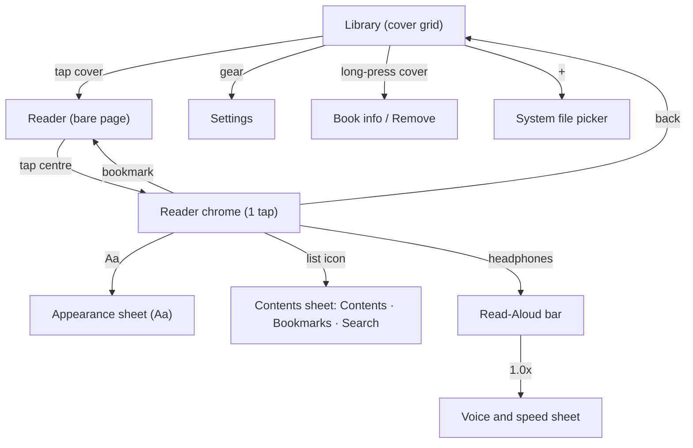

# MiniBook (`Books`) — Product & UX Design

> A minimalist ebook reader for **Android, iOS and the PC (local Web App)**, benchmarked against **Apple Books** for calm: a quiet shelf, a page of text, nothing else — plus **Read Aloud (TTS)** and a first-class **Android E-Ink mode (`墨水屏模式`)**.
> One React UI, one TypeScript core, thin hosts (same monorepo shape as MiniPod / Kotori, zero native Node addons).
>
> **Revision V2** (resolves design-critic review #5).
> Companion documents: [ARCHITECTURE.md](ARCHITECTURE.md) (packages, parsers, pagination, TTS pipeline, native hosts) · [TTS_RESEARCH.md](TTS_RESEARCH.md) (measurements of the local `qwen-tts`, market comparison, verdict).

| | |
|---|---|
| Repo / packages | `minibook` monorepo · `@minibook/{core,ui,host-node,host-android}` |
| User-facing name | **Books** (follows `miniplayer`→`Play`, `minipod`→`Podcasts`, `minifile`→`Files`) |
| Android | Capacitor 8 standalone APK, `appId dev.minibook.app` |
| iOS | `//experimental/users/chii/ios/minibook:MiniBookApp` (Capacitor-8-compatible `WKWebView` host + Swift plugins, same web bundle as Android) |
| PC | `@minibook/host-node`: Hono loopback server + `node:sqlite` + the same UI in the browser |
| Formats | `.epub` (2/3) · `.azw3` (KF8) · `.mobi` · `.fb2` (`.fb2.zip`) · `.txt` · `.md` |

---

## 1. Product principles

| # | Principle | Consequence |
|---|-----------|-------------|
| P1 | **One job: open a book → read (or listen) → come back to the same spot.** | Every screen serves one of those verbs or it is cut. |
| P2 | **The page is the product.** | While reading, zero pixels of chrome. One tap reveals a single thin layer of controls; nothing is ever permanently docked over the text. |
| P3 | **Typography over features.** | Effort goes into margins, measure, leading, justification, hyphenation and CJK line-breaking — not into toggles. Defaults must be right; settings are few. |
| P4 | **Formats are plumbing, not UI.** | EPUB, KF8, MOBI, FB2, TXT and Markdown all land in the same shelf and the same reader. The user never sees a format name except in *Book info*. |
| P5 | **No configuration before value.** | Fresh install → one button (*Add books*). Read Aloud works on first tap with the system voice: no key, no download, no account. |
| P6 | **Listening is reading.** | Read Aloud is not a separate player: it moves the same position, highlights the same text and turns the same pages. Stop listening → you are exactly where the voice was. |
| P7 | **E-Ink is a peer, not a theme.** | E-Ink mode changes *behaviour* (no motion, no scrolling, no translucency, discrete repaints, hardware keys), not just colours. Every component has a specified E-Ink form. |
| P8 | **Same app everywhere.** | Identical features on Android, iOS and PC; only the shell adapts (touch zones vs. keyboard, sheets vs. popovers). |

## 2. Scope

### 2.1 Kept

| Capability | Form in MiniBook |
|---|---|
| Library | One screen: a grid of covers, most recently read first. Nothing else. |
| Import | *Add books* (system file picker, multi-select) · "Open with Books" / share sheet from other apps · drag-and-drop + `minibook <file>` on PC. Files are **copied** into the app's own storage. |
| Reading | Paginated, reflowable, one column (two-page spread on wide landscape windows). Tap/swipe/keys to turn. |
| Appearance | 4 themes, 3 font choices, text size, line spacing, margins, justify on/off. One sheet. |
| Navigation | Contents (TOC) · Bookmarks · Search in book · a position scrubber. One sheet with three tabs. |
| Position | Automatic, exact (character-level), survives reflow, font change and rotation. |
| Read Aloud | Sentence-by-sentence TTS with highlight, auto page-turn, speed, sleep timer, background / lock-screen playback. |
| E-Ink mode | Auto-detected on E-Ink Android devices, manual toggle everywhere. §8. |

### 2.2 Cut (explicitly — the anti-bloat list)

| Apple Books / typical reader feature | Why it goes |
|---|---|
| Store, recommendations, "Reading Now" hero, Want-to-Read, samples | Not an ebook *shop*. The library is the home screen. |
| Reading goals, streaks, statistics, year-in-review, "time left in book" estimates | Vanity. The only number shown is where you are. |
| Collections, tags, series management, custom sort menus, list/grid toggle | One grid, sorted by last-read. Search-by-title appears only when the shelf exceeds one screen. |
| Highlights, notes, annotation export, sharing quotes | v1 has **bookmarks only**. (Selection offers exactly *Copy* and *Read from here*.) |
| Dictionary, translation, Wikipedia lookup, AI summaries | The OS already provides *Look Up* / *Translate* on text selection for free. |
| Page-curl / slide-style pickers, custom tap-zone editors, gesture customisation | One page-turn style per mode (§6). |
| Font manager, importing fonts, per-book font profiles, colour pickers | 3 font choices, 4 themes. Appearance is global. |
| Scroll mode (continuous vertical scrolling) | Pagination only. It is the Apple Books default, the only thing E-Ink can do well, and it halves the layout test matrix. |
| PDF, CBZ/comics, audiobooks (`.m4b`), DRM-protected Kindle/Adobe files | Different products. DRM files get one honest sentence: "This book is copy-protected and cannot be opened." |
| Cloud sync of position/bookmarks across devices, accounts | Not in v1. The position model (`Locator`, ARCHITECTURE §5) is device-independent so a MiniPod-style file sync can be added later without migration. |
| OPDS catalogs, Calibre integration, web downloads | Import a file. That is the whole acquisition story. |
| Multi-voice dialogue casting, pronunciation dictionaries, SSML editing, audio export | Read Aloud reads the text with one voice. |
| Embedded on-device neural TTS models + model download manager | On Android the *system TTS engine slot* already is the plugin interface (MultiTTS, sherpa-onnx, Google). See TTS_RESEARCH §5. |

Net result: **3 screens** (Library, Reader, Settings), **3 sheets** (Appearance, Contents, Read-Aloud options), **11 settings rows**.

## 3. Information architecture



There is no tab bar, no navigation drawer and no home screen other than the Library.

## 4. Screens & wireframes

### 4.1 Library

```
┌──────────────────────────────────────────┐
│                                          │
│  Library                          +   ⚙  │   large title · Add books · Settings
│                                          │
│  ┌────────┐   ┌────────┐   ┌────────┐    │
│  │        │   │        │   │        │    │   2:3 covers, 3 columns on phones
│  │ cover  │   │ cover  │   │ cover  │    │   (auto-fill: min 104 px, gap 20 px,
│  │        │   │        │   │        │    │    side margin 24 px)
│  └────────┘   └────────┘   └────────┘    │
│  ▬▬▬▬▬▭▭▭ 62%  New          Finished ✓   │   one quiet line under each cover:
│                                          │   thin progress line + %, or "New", or ✓
│  ┌────────┐   ┌────────┐                 │
│  │        │   │  Title │                 │   no cover in file → typographic cover
│  │ cover  │   │   ──   │                 │   (title + author set in the book serif
│  │        │   │ Author │                 │    on a solid tile; no generated art)
│  └────────┘   └────────┘                 │
│                                          │
└──────────────────────────────────────────┘
```

- **Order:** last opened first; never configurable. A book being imported appears immediately with a determinate progress line.
- **Titles are not printed under covers** (Apple Books style) — the cover is the label. Typographic covers carry their own title. Accessibility label = "Title, Author, 62 percent".
- **Long-press / right-click a cover** → a 3-item menu: *Book info* (title, author, format, size, added date), *Mark as finished / unread*, *Remove…* (confirm; deletes the copy, bookmarks and position).
- **Search:** a search field appears under the title only when the library has more books than fit on one screen; it filters by title/author as you type. No other filters.
- **Empty state:** centred, generous whitespace — the word "Library", one sentence ("Add EPUB, Kindle (AZW3/MOBI), FB2, TXT or Markdown files."), one button *Add books*. On PC the sentence adds "or drop files here".
- **Import errors** are per-file, inline on the placeholder tile ("Copy-protected", "Not a readable book"), dismissed by tap. No modal dialogs.

### 4.2 Reader — the bare page (default state)

```
┌──────────────────────────────────────────┐
│                                          │   ← safe-area top (status bar hidden
│                                          │      on Android/iOS while reading)
│      It was the best of times, it was    │
│   the worst of times, it was the age of  │   text block: max measure 34 em,
│   wisdom, it was the age of foolishness, │   side margin ≥ 24 px (setting: S/M/L),
│   it was the epoch of belief, it was the │   top/bottom margin 48 px + safe area
│   epoch of incredulity, it was the sea-  │
│   son of Light, it was the season of     │
│   Darkness, it was the spring of hope,   │
│   it was the winter of despair.          │
│                                          │
│      We had everything before us, we     │
│   had nothing before us, …               │
│                                          │
│                                          │
│                  3 pages left in chapter │   ← the only persistent element:
└──────────────────────────────────────────┘     one 11 px caption, 40 % opacity
                                                  (tap it to cycle: pages left in
                                                   chapter → book % → hidden)
```

Nothing else is on screen: no header, no title, no clock, no battery, no progress bar.

**Touch map (phones/tablets):**

```
┌───────────┬────────────────┬───────────┐
│           │                │           │
│  previous │  toggle chrome │   next    │     left 28 % · centre 44 % · right 28 %
│   page    │                │   page    │     swipe left/right = next/previous
│           │                │           │     (RTL books: mirrored automatically)
└───────────┴────────────────┴───────────┘
```

- Tapping a **link** (footnote, cross-reference, TOC entry inside the book) follows it; internal jumps push the old position so the chrome shows a "↩ Back to p. 41" pill once.
- **Long-press on text** selects it (native selection handles). While a selection exists, a two-item bar sits at the bottom edge: **Copy** · **Read from here**. The OS's own selection menu (*Look Up / Translate / Share*) is left untouched; MiniBook adds nothing else.
- **Images** are fitted to the page; double-tap opens the image alone on a plain background, pinch to zoom, tap to close.

### 4.3 Reader chrome (one tap on the centre)

```
┌──────────────────────────────────────────┐
│  ‹ Library                 🔖   ☰   Aa  🎧 │   top row: back · bookmark · contents ·
│                                          │            appearance · read aloud
│      It was the best of times, it was    │
│   the worst of times, …                  │   the page stays fully visible and
│                                          │   un-dimmed underneath (no scrim)
│                                          │
│                                          │
│                                          │
│   A Tale of Two Cities · Book the First  │   book · chapter (one line, ellipsised)
│   ──●───────────────────────────────  7% │   position scrubber (drag = preview
└──────────────────────────────────────────┘    bubble "Chapter 3 · 12 %"; release
                                                 = jump; "↩ Back" pill appears)
```

- Five controls, one row, icon-only, 44 pt targets. No overflow menu, no second row.
- **🔖** toggles a bookmark for the current page (filled when set). That is the entire bookmarking UI.
- The chrome hides on the next tap, on any page turn, or after 4 s without interaction.
- The chrome is two solid bars (theme background colour, hairline divider); no blur, no gradients, so the same layout works unchanged in E-Ink mode.

### 4.4 Appearance sheet (`Aa`)

```
┌──────────────────────────────────────────┐
│                  ▔▔▔                     │
│   A−            Aa 100 %            A+   │   text size: 12 steps (80 %…200 %)
│                                          │
│  ( Original )  ( Serif )  ( Sans )       │   font: publisher's · Literata + system
│                                          │         serif CJK · system sans
│   ○ White   ○ Paper   ○ Gray   ● Night   │   theme swatches (the swatch IS the label)
│   [x] Match system light/dark            │
│                                          │
│   Line spacing     −   Normal   +        │   Tight · Normal · Loose
│   Margins          −   Medium   +        │   Narrow · Medium · Wide
│   Justify text                    [on]   │
└──────────────────────────────────────────┘
```

- Changes apply live to the page behind the sheet; the reading position (first visible character) is preserved exactly.
- Appearance is **global** (not per book). "Original" keeps the publisher's fonts and paragraph styling; *Serif* / *Sans* override font family only. Publisher colours are always overridden by the theme (ARCHITECTURE §6.4).
- Steppers, not sliders: every control is a discrete tap (also what E-Ink needs).

| Theme | Background | Text | Notes |
|---|---|---|---|
| White | `#FFFFFF` | `#1C1C1E` | default light |
| Paper | `#F4ECD8` | `#3B3024` | warm sepia |
| Gray | `#3A3A3C` | `#D8D8DC` | low-contrast dark ("Quiet") |
| Night | `#000000` | `#B8B8BC` | OLED black, default dark |
| *E-Ink* | `#FFFFFF` | `#000000` | not a swatch — applied by E-Ink mode (§8), replaces the row |

### 4.5 Contents sheet (`☰`)

```
┌──────────────────────────────────────────┐
│   Contents      Bookmarks      Search    │   3 segments
├──────────────────────────────────────────┤
│   Book the First — Recalled to Life      │
│     I.  The Period                    1% │   current chapter in bold
│   ▸ II. The Mail                      3% │   nested TOC levels indented 16 px
│     III. The Night Shadows            5% │   tap = jump and close
│   …                                      │
└──────────────────────────────────────────┘
```

- **Bookmarks:** list of "chapter · % · first line of the page"; swipe (or ✕ in E-Ink mode) to delete.
- **Search:** one field; results stream in as "…snippet with **match**… · chapter"; tap = jump (the match is highlighted on the page until the next page turn). Plain substring search, case/width-insensitive; no regex, no options.
- Books with no TOC (plain TXT without detectable chapters) show auto-detected parts ("Part 1 … Part N").

### 4.6 Read Aloud

Tapping **🎧** starts speaking from the first sentence that begins on the current page, with the system voice, and replaces the chrome with one bar:

```
┌──────────────────────────────────────────┐
│                                          │
│      It was the best of times, it was    │
│   the worst of times, ▒it was the age of▒│   current sentence: soft tint
│   ▒wisdom,▒ it was the age of foolish-   │   current word (when the voice reports
│   ness, …                                │   word timing): underline
│                                          │
│                                          │
├──────────────────────────────────────────┤
│   ✕      ⏮      ▶/⏸      ⏭     1.0×   ⏾ │   stop · prev sentence · play/pause ·
└──────────────────────────────────────────┘   next sentence · voice & speed · sleep
```

| Control | Behaviour |
|---|---|
| ▶/⏸ | Play / pause. Resume restarts the interrupted sentence from its beginning. |
| ⏮ / ⏭ | Previous / next sentence (long-press: previous / next paragraph). |
| `1.0×` | Opens the *Voice & speed* sheet: speed stepper 0.5×–3.0× (0.1 steps), the **voice list for the book's language** (system voices first; other configured engines below), and a link *More voices…* to Settings. |
| ⏾ | Sleep timer: Off · 15 · 30 · 45 · 60 min · End of chapter. On expiry the voice finishes the current sentence, then pauses. |
| ✕ | Stop Read Aloud; the page stays where the voice was. |

Behavioural contract (P6):

- **The bar auto-hides** after 4 s like the chrome; a tap on the centre brings it back. While speaking, the page shows only text + highlight.
- **Auto page-turn:** when the spoken position crosses a page boundary the page turns (instantly in E-Ink mode; with the normal page transition otherwise). Chapter ends flow into the next chapter after a slightly longer pause.
- **Turning the page yourself while it speaks** moves the voice: after a 600 ms settle, speech restarts from the first sentence on the new page. (No "detached" state, no "return to voice" button.)
- **Tapping a sentence** while Read Aloud is active jumps the voice to it. *Read from here* in the selection menu starts Read Aloud at that sentence.
- **Background:** speech continues with the screen off and from the lock screen / notification / headset buttons / desktop media keys (play-pause, previous/next sentence). The reading position is saved at every sentence, so killing the app loses at most one sentence.
- **Footnote markers, page numbers, ruby annotations and image captions marked decorative are not read aloud.** Headings are read with a longer pause after them.
- **If a network voice cannot keep up or the network drops**, speech falls back to the system voice at the next sentence and a one-line, non-modal notice says so ("Using system voice — network voice unavailable"). It never just stops silently.
- **If a voice is slower than real time** (measured, see TTS_RESEARCH §2), the voice sheet says so in one line ("This voice generates 4.5× slower than it speaks; expect pauses") and offers the system voice.

### 4.7 Settings (11 rows, one screen)

```
┌──────────────────────────────────────────┐
│ ‹  Settings                              │
├──────────────────────────────────────────┤
│ READING                                  │
│  E-Ink mode              Auto ▸          │   Auto · On · Off              (§8)
│  Volume keys turn pages  [on]            │   Android only; default on in E-Ink mode
│  Full refresh            Every 10 pages ▸│   E-Ink mode only: Off · 5 · 10 · 20
│  Text boldness           −  1  +         │   E-Ink mode only: 0–3          (§8.4)
│  Keep screen on          [on]            │   while reading (not on E-Ink)
├──────────────────────────────────────────┤
│ READ ALOUD                               │
│  Voice                   System · Tingting ▸   per-language voice list
│  Edge neural voices      [off]           │   free online voices (opt-in)
│  Custom speech server    Not set ▸       │   OpenAI-compatible URL · key · voice
│  Fall back to system voice  [on]         │
├──────────────────────────────────────────┤
│ ABOUT                                    │
│  Storage                 412 MB ▸        │   books · speech cache (Clear)
│  Version 0.1.0 · Licenses                │
└──────────────────────────────────────────┘
```

Rows that do not apply to the platform or mode are **hidden, not disabled** (capabilities over greyed-out rows): iOS and PC never show *Volume keys*; the three E-Ink rows appear only while E-Ink mode is active.

### 4.8 PC Web App shell (window ≥ 840 px)

Same screens, nothing added.

- **Library:** the grid simply gets more columns (max content width 1200 px, centred).
- **Reader:** text block capped at 34 em and centred; windows ≥ 1100 px wide in landscape show a **two-page spread** (two columns, 64 px gutter). Sheets become 360 px popovers anchored to their toolbar icon.
- **Keyboard:** `←`/`→`/`PageUp`/`PageDown`/`Space`/`Shift+Space` turn pages · `Esc` closes sheet → chrome → book · `T` contents · `/` or `Ctrl/⌘+F` search · `B` bookmark · `A` appearance · `R` read aloud start/stop · `P` or media keys play/pause · `[` / `]` speed.
- **Mouse:** click zones as touch; wheel/trackpad horizontal or vertical scroll = one page per gesture (debounced 250 ms).

## 5. Typography & visual specification

Typography is the feature (P3); these are requirements, not suggestions.

| Property | Value |
|---|---|
| Body font (*Serif*) | **Literata** (variable, OFL, bundled woff2 ≈ 300 kB, Latin/Cyrillic/Greek) → system serif CJK fallback: `"Songti SC"`, `"Noto Serif CJK SC/TC/JP/KR"`, `"Source Han Serif"`, `serif` |
| Body font (*Sans*) | `system-ui`, `"PingFang SC"`, `"Noto Sans CJK"`, `sans-serif` |
| *Original* | Publisher CSS fonts (embedded EPUB/KF8 fonts are loaded); falls back to *Serif* stack |
| Base size | 100 % = 18 px (phones) / 19 px (≥ 840 px); 12 steps from 80 % to 200 % |
| Line height | Tight 1.45 · **Normal 1.6** · Loose 1.8 (CJK-majority books: +0.1) |
| Measure | **max 34 em per column, always** — on wide windows the column is centred and the extra width becomes margin; side margins are never smaller than the *Margins* setting (Narrow 24 · **Medium 32** · Wide 48 px; ≥ 840 px: ×1.5). Two-page spreads keep an inner gutter ≥ 64 px. Exact geometry: ARCHITECTURE §6.3 |
| Paragraphs | Publisher's choice in *Original*; otherwise first-line indent 1.5 em (CJK: 2 em), no inter-paragraph gap; scene breaks keep their space |
| Justification | On by default with `hyphens: auto` (uses the book's `lang`); CJK: `text-align: justify`, `line-break: strict`, `text-spacing-trim`/`text-autospace` where the engine supports them (progressive enhancement) |
| Widows/orphans | `widows: 2; orphans: 2`; headings `break-after: avoid`; figures `break-inside: avoid` |
| UI font | system UI font, 3 sizes only: 28 px large title · 16 px body · 12 px caption |
| UI colours | Each theme defines exactly 4 tokens: `--bg`, `--fg`, `--fg-quiet` (captions), `--line` (hairlines). One accent (`--accent`, system blue / `#0A84FF`) is used only for the scrubber thumb, toggles and links. |
| Motion (non-E-Ink) | Page turn: 180 ms horizontal slide (the only page animation). Sheets: 220 ms rise. `prefers-reduced-motion` → all 0 ms. |
| Icons | 6 line icons total (back, bookmark, contents, Aa, headphones, gear) + transport glyphs; 1.5 px stroke, no fills |
| Whitespace | Library side margin 24 px, grid gap 20 px, large-title top inset 56 px. Nothing is boxed in cards. |

## 6. Interaction details

| Situation | Behaviour |
|---|---|
| Opening a book | Opens at the last position; first open → cover/title page. Target ≤ 400 ms to first page for a typical chapter (mid-range phone). |
| Page turn (default) | 180 ms slide. Chapter boundary turns look identical to in-chapter turns. |
| Rotation / resize / font change | Re-paginate, keep the first visible character on screen. |
| End of book | Last page turn shows a quiet end page ("Finished" + *Back to Library*); book is marked ✓. |
| Android back / iOS edge-swipe | Closes sheet → chrome/Read-Aloud bar → returns to Library. Read Aloud keeps playing when you leave to the Library; a 1-line mini bar "▶ Title — tap to return" sits at the bottom of the Library (tap = back into that book at the spoken sentence; its ▶/⏸ works in place). |
| Opening another book while Read Aloud is active | **One book at a time.** Opening a different book stops Read Aloud for the first one (its position is saved at the sentence being spoken) and the mini bar disappears; tap 🎧 in the new book to listen there. Re-opening the same book simply rejoins the voice. |
| RTL books | Page progression and tap zones mirror automatically from the book's metadata. |
| Vertical-writing books (`writing-mode: vertical-rl`) | v1 lays them out horizontally (documented limitation; true vertical pagination is the first post-v1 item). |
| Fixed-layout EPUBs | Opened page-per-screen, scaled to fit, no reflow settings, Read Aloud disabled; a known-limited mode, not a goal. |
| Errors | One calm sentence in place of content, with one action (*Back to Library*). Never a stack trace, never a modal chain. |

## 7. Read Aloud — voice sources as the user sees them

Detailed reasoning and measurements are in [TTS_RESEARCH.md](TTS_RESEARCH.md); the UX consequence is a **three-rung ladder**, each rung optional and additive:

| Rung | What the user does | What they get |
|---|---|---|
| 0. **System voice** (default) | Nothing. | Works offline, free, in the background, with word highlighting where the OS voice supports it. On Android this includes any engine the user installed as the system TTS (Google, **MultiTTS**, **sherpa-onnx TTS** with Kokoro/Piper/Matcha/VITS voices) — MiniBook lists every installed engine and its voices. |
| 1. **Edge neural voices** | Flip one switch. | Free, very natural online voices (e.g. `zh-CN-XiaoxiaoNeural`, `en-US-AvaMultilingualNeural`) with word timing. Needs network; unofficial service, so it can break — falls back to rung 0 automatically. |
| 2. **Custom speech server** | Enter URL (+ key, voice name). | Any OpenAI-compatible `/v1/audio/speech` endpoint: OpenAI itself, a self-hosted Kokoro server, or the user's own LAN TTS box. Sentence highlighting only. |

There is deliberately no fourth rung, no model downloader and no per-provider settings page.

## 8. E-Ink mode (`墨水屏模式`)

### 8.1 Activation

| Setting value | Behaviour |
|---|---|
| **Auto** (default) | On when the host reports an E-Ink display: Android native detection by device fingerprint (Onyx Boox, Meebook/Boyue/Likebook, Bigme, Hisense A-series/Touch, Xiaomi Moaan/InkPalm, iReader, Dasung, PocketBook, Tolino, Nook, Supernote, iFLYTEK, Kobo-on-Android… ARCHITECTURE §9.1), or — on any platform — the CSS media queries `(update: slow)` / `(monochrome)`. The first time Auto turns it on, a one-line notice appears once: "E-Ink mode is on · Settings". |
| **On** | Forced on (any device: E-Ink monitors on PC, unlisted devices, or simply taste). |
| **Off** | Forced off (e.g. colour E-Ink owners who prefer the normal UI). |

E-Ink mode sets `data-eink="1"` on the root element; everything below is driven from that single switch.

### 8.2 The rules (apply to the whole app, not only the page)

**R1 — Two colours.** UI and text use only `#FFFFFF` and `#000000`. There is no grey token: `--fg-quiet` = `#000`, `--line` = `#000`, `--accent` = `#000`. Hierarchy is expressed by **size, weight, underline, inversion and borders**, never by tint.

| Normal-mode device | E-Ink replacement |
|---|---|
| Grey secondary text, 40 %-opacity captions | Black, smaller size |
| Hairline / tinted dividers | 1 px solid `#000` |
| Selected item tint, hover tint | **Inverted** (black fill, white text) or 2 px solid border |
| Disabled controls (greyed) | Hidden; or, if position must be kept, 1 px **dashed** border and no fill |
| Accent-coloured links | Black + underline |
| Translucent scrim behind sheets | **None.** Sheets are opaque white with a 2 px black border; the page behind stays as is |
| Elevation (`box-shadow`), `text-shadow`, `backdrop-filter`, `filter`, gradients, `opacity` < 1, `rgba()`/`hsla()` fills, `mix-blend-mode` | **Forbidden** in E-Ink mode. Enforced by a stylesheet lint (ARCHITECTURE §9.2), not by convention |
| Rounded corners | Radius 0 (crisp 1-bit edges; no anti-aliased arcs) |
| Text-selection colour | `::selection { background:#000; color:#fff }` |
| Progress line under covers | Text only: "62 %" |
| Toggle switches | Text toggles `[ On ]` / `[ Off ]`, the active one inverted |
| Sliders (text size, speed, scrubber) | **Steppers** (`−` value `+`); the position scrubber becomes `‹ Chapter` · `12 %` · `Chapter ›` + a *Go to %* field |
| Book content colours | All text forced to `#000` on transparent; publisher backgrounds/borders/coloured text neutralised; links underlined. **Images are left untouched** (the panel dithers photographs itself; that is correct and unavoidable) |
| Font smoothing | Greyscale anti-aliasing only (no LCD sub-pixel colour fringes) |

Note on honesty: *glyph anti-aliasing* still produces intermediate greys at stroke edges — that is how E-Ink panels render good text under their 16-level waveforms and is intended. What R1 eliminates is every **area fill, overlay and effect** that would make the panel dither or ghost.

**R2 — Zero motion.** `transition: none`, `animation: none`, `scroll-behavior: auto` on everything. Page turns are instantaneous swaps (no slide). Sheets, menus, the chrome and the Read-Aloud bar appear and disappear in one frame. No ripple, no skeleton shimmer, **no spinners**: indeterminate waits show the static word "Loading…"; determinate ones show stepped text ("Importing 3 / 12"), updated at most once per second. Animated GIF/APNG/WebP images in books are frozen on their first frame. The text caret in input fields does not blink.

**R3 — No scrolling, anywhere.** Scroll smear is the worst E-Ink artefact, so *every* list is paginated:

- Library grid, Contents, Bookmarks, Search results, Settings and voice lists render exactly one screenful with a footer `‹  2 / 5  ›`.
- A swipe is recognised on finger-up and flips one page (no content follows the finger); page keys and volume keys do the same. `overscroll-behavior: none`; no inertial scrolling, no rubber-banding, no pull-to-refresh.

**R4 — Repaint as little and as rarely as possible.**

- The 4-second auto-hide timers are disabled (the chrome/bar closes only on an explicit tap), so the screen never changes by itself.
- Read-Aloud highlight is **sentence-level only**: a solid 2 px black underline under the current sentence (no word-by-word highlight, no tint, no box). One small repaint per sentence instead of three per second.
- While Read Aloud plays, the Read-Aloud bar stays hidden unless summoned; nothing on screen moves except the underline and page turns.
- Position captions ("3 pages left in chapter") update only on page turns.

**R5 — Touch feedback without animation.** A pressed control inverts (black/white) for the duration of the touch — a single discrete state change — and returns on release.

### 8.3 Anti-ghosting full refresh

E-Ink accumulates ghosts after partial updates. MiniBook cleans them up in two layers:

| Layer | When | How |
|---|---|---|
| **Vendor refresh** (Onyx first; others as verified) | Same triggers as below | The native host asks the panel for a full-quality (GC) refresh of the reader view. No visible double flash. |
| **Software flash** (universal fallback) | Same triggers | The page is replaced by solid black for ~150 ms, then solid white, then the new page — driving every pixel through both extremes. Works on any panel without vendor APIs. |

Triggers (setting *Full refresh*: Off · every 5 · **every 10** · every 20 page turns):

1. every *N*-th page turn (the flash is merged into that turn — one flash, not turn-then-flash);
2. after closing a sheet or the chrome (large inverted areas leave the strongest ghosts) — counted as a turn towards *N*, and forced if the sheet covered more than half the screen;
3. on demand: a **Refresh** item appears in the reader chrome in E-Ink mode (the sixth icon, E-Ink only).

On devices whose system already forces its own per-app refresh cadence (e.g. Boox "E-Ink Center"), users can set *Full refresh: Off* to avoid doubling; the default stays conservative (10).

### 8.4 Typography weight compensation

E-Ink renders thin strokes lighter than LCD/OLED. In E-Ink mode:

- body weight is raised one step (Literata 400 → 500; UI text 400 → 500, labels 600);
- **Text boldness** (0–3, default 1) additionally thickens *any* font — including single-weight CJK system fonts and publisher fonts — by stroking glyph outlines (0 / 0.2 / 0.4 / 0.6 px), so the control works for every book;
- minimum body size is 100 % of base; line spacing defaults to *Normal* and cannot go below it;
- italics remain italic (no synthetic slanting changes), small-caps and thin display weights in publisher CSS are clamped to ≥ 400.

### 8.5 Hardware keys

| Key | Reader (no sheet open) | Lists in E-Ink mode | Read Aloud **playing** | Read Aloud paused / off |
|---|---|---|---|---|
| Volume Down | Next page | Next list page | **System volume** (not intercepted) | Next page |
| Volume Up | Previous page | Previous list page | **System volume** (not intercepted) | Previous page |
| Page Down / Page Up, D-pad Right / Left, Space | Next / previous page | Next / previous list page | Next / previous page — and the voice follows (§4.6) | Next / previous page |
| Media Play/Pause, headset button | Start / pause Read Aloud | — | Pause | Resume |
| Media Next / Previous | — | — | Next / previous sentence | Next / previous sentence |

Rules:

- *Volume keys turn pages* is a setting (default **on** in E-Ink mode, **off** otherwise; Android only — iOS does not allow it and the row is hidden there).
- **While the voice is audibly speaking, volume keys always mean volume.** The moment speech is paused or stopped they turn pages again. This is decided natively, so there is no lag or wrong guess when the web layer is busy (ARCHITECTURE §9.5).
- Volume keys page **whatever pageable thing is on top**: the book page, or a paged list — including lists inside sheets (Contents, Bookmarks, Search results, voice list). On a non-list sheet (Appearance, sleep timer, dialogs) they keep their normal volume function.
- Volume keys are never captured outside the foreground app, never with the screen off, and never while a text field has focus. Key auto-repeat is ignored (one press = one page) so a held key cannot smear through a chapter.
- Dedicated page-turn buttons on E-Ink devices arrive as Page Up/Down or as volume keys depending on the vendor's own setting; both paths work.

### 8.6 E-Ink mode acceptance checklist

1. With E-Ink mode on, a full-app screenshot crawl (every screen and sheet) contains **no pixel that is not `#FFFFFF` or `#000000`** outside the anti-aliased edges of text glyphs and line icons, and outside images (book images, cover art). (Automated: render with font anti-aliasing disabled and with book images, cover images and `<svg>` icons masked, then assert a strict two-colour histogram.)
2. No computed style in the UI has a non-zero transition/animation duration, a `box-shadow`, `backdrop-filter`, `filter`, or an alpha < 1 colour. (Automated DOM walk in tests.)
3. No element is scrollable (`scrollHeight > clientHeight` with `overflow` scroll/auto) in any screen.
4. Read Aloud for 60 s on a static page causes exactly one repaint per sentence boundary and none in between.
5. Volume keys: turn pages when silent, change volume when speaking, verified on a real device.
6. A full refresh occurs on the configured cadence and never twice for one page turn.

## 9. Platform differences (the complete list)

| | Android | iOS | PC Web |
|---|---|---|---|
| Add books | SAF picker, *Open with* / share intents | Files picker, *Open in Books* / share sheet, iTunes/Finder file sharing | file picker, drag-and-drop, CLI argument |
| Read Aloud default voice | Android `TextToSpeech` (any installed engine) | `AVSpeechSynthesizer` | browser `speechSynthesis` |
| Background / lock screen | Media notification + lock screen + Bluetooth (foreground service) | Lock screen / Control Center / AirPods | tab keeps speaking; OS media keys via Media Session |
| E-Ink auto-detect | device fingerprint + media queries | media queries only | media queries only |
| Volume-key page turn | yes | no (row hidden) | n/a (keyboard) |
| Vendor full refresh | Onyx (others as verified) → else software flash | software flash | software flash |
| Status bar while reading | hidden (immersive) | hidden | n/a |

## 10. Accessibility & localisation

- UI strings in `en`, `zh-CN`, `ja` (same set as MiniPod). Book language drives hyphenation, line-breaking and voice choice — independent of UI language.
- All controls have accessible names; the reader exposes the page text to screen readers and page-turn actions as accessibility actions. Dynamic Type / system font scale multiplies the UI font sizes (not the book text, which has its own control).
- Contrast: all themes meet WCAG AA for body text (Gray 9.6:1, Night 10.5:1, Paper 10.9:1).
- `prefers-reduced-motion` disables the page slide and sheet rise (same code path as E-Ink R2).

## 11. Definition of done (product level)

1. Fresh install → *Add books* → pick an `.epub`, `.azw3`, `.mobi`, `.fb2`, `.txt`, `.md` → each opens to a correctly typeset first page on Android, iOS and PC.
2. Close and reopen any book: same first visible word. Change font size or rotate: same first visible word.
3. A 10 MB GB18030 `.txt` web novel imports in < 5 s on a mid-range phone, shows a chapter list, and turning pages never stalls > 100 ms within a chapter.
4. Read Aloud: tap 🎧 → speech within 1 s (system voice); screen off for 30 minutes → still reading, position correct on wake; lock-screen pause/resume works; sleep timer stops at a sentence end.
5. E-Ink checklist §8.6 passes on an Onyx Boox device and in a desktop browser with E-Ink mode forced on.
6. The settings screen has ≤ 11 rows and the reader chrome ≤ 5 icons (6 in E-Ink mode). Any PR that adds a row or an icon must remove one.
